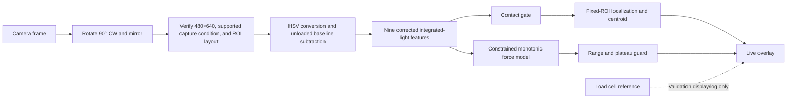

# Live Optical Force Sensor GUI — Master Plan

**Project:** Nine-ROI optical sensing skin  
**Plan status:** Execution-ready master specification; implementation, physical validation, and final model validation pending  
**Reviewed:** 2026-08-13  
**Datasets:** `Manual Calibration (2).zip` for primary model development/validation; `Auto Calibration.zip` for controlled cyclic sensor characterization  
**Hardware availability:** The actual optical sensor is currently connected to the laptop by USB and is available for device discovery, live integration, replay-to-hardware parity, and authorized physical bench testing  
**Primary goal:** Thesis-valid force estimation and force localization in a separate live runtime GUI

## 1. Outcome

Build a separate PySide6 live-sensor application that uses the existing camera, baseline, ROI, processing, load-cell, recording, and simulation services where appropriate. The application will:

1. detect contact in one of nine fixed ROIs;
2. draw a box around the fixed ROI containing the dominant optical response;
3. show an optional intensity-weighted centroid inside that ROI;
4. estimate normal force only inside a validated optical range;
5. stop giving an exact force when the optical response reaches its material or imaging limit; and
6. fail closed when the camera, orientation, ROI layout, baseline, or model is incompatible.

The load cell is reference-only during validation. It must never be an input to, correction for, or hidden fallback for the optical force estimate.

## 2. Scope and claim boundary

### Version 1 scope

- One normal contact at a time.
- The same sensing skin, camera, lighting geometry, lens position, and orientation represented in the dataset and validated for release. Recorded sharpness differences are allowed.
- Nine fixed, non-editable ROIs.
- Contact/detection study target: **0 to 3.0 N**, subject to the common validated plateau limit. Exact force estimation begins only at the training-derived `Fdetect`; a valid no-contact state displays `0.00 N` separately.
- Localization output: active ROI number, fixed ROI box, confidence state, and heuristic centroid.
- Controlled cyclic characterization of hysteresis, speed dependence, cycle repeatability, short-term fixed-displacement relaxation, unloaded recovery, and noise-equivalent-force resolution proxy using the automated archive.
- Windows desktop runtime using PySide6.

### Explicitly out of scope for Version 1

- Multiple simultaneous contacts or separate force estimates for multiple contacts.
- Shear force or force direction.
- Generalization to a different sensing skin, camera, lighting arrangement, ROI geometry, or acquisition condition not represented and validated in the model study.
- Exact force above the validated optical range.
- Treating the centroid as millimetre-accurate contact location without a separate spatial calibration.

The thesis claim must be limited to the tested hardware and acquisition conditions.

## 3. Decision register

| Area | Final decision |
|---|---|
| Runtime | Add a separate live entry point inside the existing codebase; do not expand the calibration GUI into the runtime UI. |
| Connected hardware | The actual optical sensor is already connected to the laptop through USB. Hardware discovery and read-only capture checks may begin when implementation reaches them; still verify the exact device/backend/mode and ask the operator to confirm the sensor is unloaded before baseline capture or inference. |
| Usability | Design for a first-time laboratory operator: one guided setup path, one obvious primary action per step, safe defaults, plain-language statuses, progressive disclosure of advanced details, and recovery instructions beside every blocking error. |
| Accessibility | Never rely on color alone. Pair every state with text and an icon/pattern, provide keyboard navigation and accessible control names, support Windows display scaling, and keep critical text readable at the minimum supported window size. |
| Quantitative image source | Use the oriented original frame and background subtraction. Motion magnification is visualization-only. |
| Source-data safety | Treat both ZIP archives as immutable read-only evidence. Never edit, rename, recompress, or write inside `Downloads`; stage only the current session into a project-controlled cache after disk-space and CRC checks. |
| ROIs | Use the dataset's fixed nine-ROI layout. Do not expose draw, resize, or edit controls in the live runtime. |
| Light feature | Use integrated positive baseline-subtracted HSV V per ROI, corrected for the no-contact noise floor. |
| Physical prior | More corrected light may maintain or increase predicted force; it may never lower predicted force. |
| Force-model selection | Compare multiple linear, regularized, monotonic nonlinear, tree, kernel, and neural candidates using the same session-held-out protocol. Do not choose the model in advance. |
| Deployment eligibility | The selected live model must be nonnegative, monotonic with increasing corrected light, fast enough for the GUI, and compliant with the validated force limit. Unconstrained models may be reported as benchmarks but cannot be deployed if they violate these rules. |
| Selection rule | Among models that pass every release gate, select the lowest session-balanced outer-fold end-to-end displayed-force MAE, with conditional regression MAE reported separately. If models are statistically tied within one standard error across the six TEST groups, choose the simpler and faster model. |
| Camera settings | Use all six TEST1–TEST6 press sessions for every ROI. Sharpness is provenance only: it does not exclude a session or block inference. Other recorded settings are evaluated as robustness strata rather than silently filtered to improve results. |
| Dataset roles | Keep the manual and automated archives distinct. Use the six independent manual TEST sessions per ROI for the primary force/localization model comparison. Use the 162 automated cyclic sessions for controlled sensor characterization. Do not let repeated automated cycles dominate model fitting or validation. |
| Automated protocol | Preserve speed, displacement, cycle, motion phase, collection day, and session identity. Average cycles within a session before session-level inference; a 10-cycle or 20-cycle run is one independent session, not 10 or 20 independent experiments. |
| Data-analysis visualizations | Produce reproducible graphs wherever they make coverage, force response, plateau, model performance, localization, uncertainty, or latency easier to judge. Thesis performance figures must use outer session-held-out predictions. |
| Sensor characterization | Calculate every defensible metric supported by the recordings: sensitivity, local sensitivity, nonlinearity, repeatability, spatial uniformity, cross-talk, SNR, optical detection threshold, noise-equivalent force, model bias/error, short-term drift, system lag, qualified hysteresis, short-term relaxation/recovery, and qualifying creep. Mark conditional metrics exploratory when their protocol or trajectory-coverage gate fails; do not convert missing evidence into a numerical claim. |
| Resolution claim | The automated cycles may improve the noise-equivalent-force and minimum-detectable-force estimates, but they do not establish true force resolution. Claim true resolution only after a separate repeated small-force-step protocol passes. |
| Gate governance | Freeze metric definitions, thresholds, folds, seeds, candidate lists, and release gates before opening outer-fold results. Any later change receives a versioned decision-log entry, invalidates the old selection comparison, and triggers the affected analyses again. |
| Nominal force range | Target 0–3.0 N. The released common range is the lower of 3.0 N and the lowest safely validated ROI plateau limit. |
| Above range | Display `Force ≥ Fmax — optical limit reached`; do not extrapolate, clamp to an exact number, or silently reuse the last value. |
| Near range limit | Warn at 90% of the loaded model's limit; this is 2.7 N when `Fmax = 3.0 N`. |
| No contact | Display 0.00 N only after the no-contact gate passes; otherwise show unavailable rather than inventing a value. |
| Localization | Compare the normalized-light argmax baseline with several nine-class learning models, including XGBoost. The selected class activates its already-fixed ROI box; no bounding-box regression is needed. Force and localization remain separate outputs. |
| Box behavior | No contact: no active box. Valid contact: green box. Ambiguous response: amber box. Optical limit: red box. |
| Stability | Require two consecutive frames to acquire, switch, or clear the active ROI state. |
| Optical input support | Store a training-derived multivariate feature-support envelope in the release bundle. Inputs outside validated support produce `Outside calibrated optical response` and no exact force; the GUI must not extrapolate merely because a model can return a number. |
| Operator safety | Any invalid camera, model, layout, baseline, freshness, or optical-support condition pauses inference, clears the numeric force estimate, preserves recoverable work, and presents the next corrective action. A recording-only fault stops/marks recording but may leave scientifically safe sensing active. Never leave a stale force value on screen. |
| Load cell | Display/log as optional reference in Validation mode only; never feed it into optical inference. |
| Release label | Show `Experimental optical force estimate` until every release gate passes. |
| Failed-gate outcome | If no force/localization bundle passes, do not promote a model or weaken a gate after seeing results. Preserve the analysis, keep the runtime in labelled replay/experimental mode, and request a documented scope decision or new data. A detection/localization-only release is a separate user-approved scope, not an automatic fallback. |

## 4. Canonical fixed ROI contract

Both archives contain the same canonical oriented layout. The acquisition transform is:

```text
raw camera frame 640×480
→ rotate 90° clockwise
→ oriented frame 480×640
→ mirror horizontally
→ final analysis frame 480×640
```

The mirror changes horizontal positions but does not change the final width and height. All baseline pixels, ROI coordinates, optical features, localization labels, overlays, and model inputs use this final coordinate system.

Canonical layout:

- Frame: **480 px wide × 640 px high**
- Orientation used during collection: 90° clockwise rotation followed by horizontal mirroring
- Layout ID: `roi-9fbc67c50ee3bc7145fa`

| ROI | x | y | width | height |
|---:|---:|---:|---:|---:|
| 1 | 98 | 161 | 82 | 89 |
| 2 | 197 | 156 | 76 | 99 |
| 3 | 312 | 154 | 58 | 97 |
| 4 | 100 | 268 | 73 | 89 |
| 5 | 204 | 264 | 76 | 96 |
| 6 | 314 | 260 | 66 | 94 |
| 7 | 104 | 383 | 73 | 77 |
| 8 | 194 | 394 | 87 | 66 |
| 9 | 312 | 379 | 61 | 77 |

These coordinates and rectangle dimensions are defined **after** the 90° clockwise rotation and horizontal mirror. Their different widths and heights are intentional properties of the fixed oriented layout and do not mean that ROI 9—or any other ROI—has less experimental coverage. The runtime must transform the camera frame first, then apply these coordinates exactly once. It must not mirror/rotate the boxes a second time or resize all ROIs to one common rectangle.

For localization, ROI-size effects are controlled with area-normalized and per-ROI response-normalized optical features so a larger rectangle does not win merely because it contains more pixels. The raw integrated-light sums remain available to the force-model comparison.

**Blocking conflict:** the repository's current `roi_layout.json` is a different 640×480 layout with ID `roi-4691aef42361b7430d3b`. It cannot be used by the live model. The live model bundle must carry the canonical dataset layout, and the runtime must compare the exact layout ID, dimensions, orientation, and coordinates before enabling inference.

## 5. Scientific measurement contract

### 5.1 Per-pixel and per-ROI light

For oriented original-frame HSV V values:

```text
signed_delta_r,t(x,y) = V_t(x,y) - B_r(x,y)
positive_delta_r,t(x,y) = max(V_t(x,y) - B_r(x,y), 0)
raw_light_r,t = sum over ROI r of positive_delta_r,t(x,y)
light_r,t = max(raw_light_r,t - no_contact_floor_r, 0)
```

Where:

- `B_r` is the accepted unloaded median V image for ROI `r`;
- `no_contact_floor_r` is learned from training-only no-contact sessions;
- `light_r,t` captures both brighter pixels and growth of the illuminated area; and
- all calculations use unannotated original pixels.

The no-contact correction is required because clipping pixel noise at zero produces a positive summed bias even when the sensor is unloaded.

Reuse the existing baseline implementation with an explicit live contract: wait the configured `3.0 s` camera warm-up, collect unannotated frames for `3.0 s`, require at least 20 valid fresh frames, and compute the per-pixel median V image plus per-ROI summaries. Bind the accepted baseline to camera device/backend/mode, raw and oriented geometry, processing/feature version, layout ID, and bundle ID. The current mean absolute ROI-mean-V drift threshold of `5.0` V units is a provisional starting value; freeze the release value from dedicated no-contact evidence and store it in the bundle.

Baseline acceptance requires the capture's ROI raw-V summaries and temporal spread/drift to lie inside the bundle's training unloaded envelope, no dropped/stale-frame violation, and the post-capture no-contact check to pass. A stable contact held throughout capture must be rejected by the unloaded-envelope check rather than becoming the new zero. Any camera/backend/mode, geometry/orientation, processing, layout, bundle, or lighting-support change invalidates the baseline. Never silently restore it after application restart.

The immutable frame feature store contains both signed and positive-delta summaries before any fold-specific no-contact floor, response scale, contact threshold, or model transform is applied. At minimum, store per ROI: signed delta sum/mean/robust spread, positive delta sum/per-pixel value, active fraction, centroid, raw V summaries, ROI area, and baseline identity. The existing `processing/feature_extraction.py` exports positive-delta features but not the required signed summaries; extend the shared extractor once and test it rather than creating a second incompatible offline formula.

`no_contact_floor_r`, response scales, model scalers, imputation rules, and thresholds belong to a fitted preprocessing object inside each training fold and later inside the release bundle. They must not be baked into the global feature store using all sessions.

### 5.2 Contact gate

Contact detection is separate from force regression:

1. Normalize each corrected ROI light value using a training-only robust response scale.
2. Compare the strongest ROI score with a threshold selected from dedicated training no-contact sessions.
3. Inside each training fold, choose the smallest threshold that meets the frozen no-contact false-positive target, then maximize contact recall; evaluate the chosen threshold unchanged on held-out contact and dedicated no-contact sessions.
4. Require two consecutive frames before declaring or clearing contact.

If the camera or baseline is invalid, contact, location, and force are all unavailable.

Zero force is a discrete `No contact` state, not a continuous regression endpoint. Within each outer fold, derive the contact-score threshold and its reference-force operating point `Fdetect` from the outer-training groups only, then apply both unchanged to that fold's held-out sessions. Primary force MAE/RMSE are computed on synchronized, valid, single-contact frames from that training-derived `Fdetect` through the independently frozen `Fmax`; evaluate no-contact behavior separately. Also report end-to-end MAE with a missed contact represented by the displayed `0.00 N`, so conditional regression error cannot hide detection failures. Frames below the fold's `Fdetect` remain in onset/detection plots but receive no thesis claim of exact force.

The nested results estimate this full threshold-selection procedure, not an untouched test of one final numeric `Fdetect`. After model selection, refit the threshold and `Fdetect` on all development groups for the experimental bundle and state that it still requires Phase H physical or new untouched confirmation before a validated release claim. Never choose a lower evaluation bound from the outer errors merely to improve MAE.

Dedicated no-contact recordings are the controlling evidence for baseline noise, threshold selection, frame-level false-positive rate, and false-contact episodes. The automated top dwell is useful for within-session residual/recovery analysis, but its temporal dependence and proximity to a preceding press prevent it from substituting for independent no-contact sessions. Assign complete dedicated no-contact sessions/dates to the split manifest before fitting.

Report both frame-level no-contact false-positive rate and false-contact episodes per minute, where an episode begins when the debounced state first enters contact and ends only after the debounced clear rule. Also report detection delay from the synchronized first crossing of `Fdetect`; do not quote only per-frame accuracy for a live contact detector.

### 5.3 Force-model comparison

Do not assume one learning model will be best. Run a controlled comparison using the same corrected-light inputs, valid force range, temporal-alignment policy, grouped folds, training weights, and evaluation metrics.

The standard multichannel input is:

```text
X_t = [light_1,t, light_2,t, ..., light_9,t]
```

All nine ROI responses are used because light can spread beyond the contacted ROI. The target ROI label and localization prediction are not force-model inputs; a localization error must not automatically corrupt force estimation.

#### Candidate models

| Family | Candidate | Purpose and deployment status |
|---|---|---|
| Simple baseline | Total-light zero-intercept linear regression | Establish whether summed light alone is sufficient. Constrain its slope to be nonnegative. |
| Physics-aligned linear | Nine-channel nonnegative least squares (NNLS) | Interpretable baseline with one nonnegative coefficient per fixed ROI. |
| Regularized linear | Positive Ridge | Reduce coefficient instability while preserving nonnegative coefficients. |
| Sparse regularized linear | Positive Elastic Net | Test whether a smaller subset of ROI responses generalizes better. |
| Monotonic univariate | Isotonic regression on total corrected light | Flexible monotonic calibration without assuming linearity. |
| Monotonic nonlinear | Constrained piecewise-linear or monotonic-spline model | Represent a knee or reduced sensitivity while preserving increasing force. |
| Monotonic tree boosting | Histogram gradient boosting with increasing constraints on all nine light inputs | Test nonlinear interactions and spillover while enforcing the physical direction. |
| Monotonic XGBoost | `XGBRegressor` with `monotone_constraints=(1,1,1,1,1,1,1,1,1)` | Test boosted nonlinear interactions using the explicit increasing-light constraint. Reject it if raw predictions become negative or it misses latency/size gates. |
| Exploratory kernel benchmark | RBF support-vector regression | Accuracy benchmark only unless it passes the full monotonic audit. |
| Exploratory tree benchmark | Random Forest or Extra Trees regression | Accuracy benchmark only; normally not deployment-eligible because monotonicity is not guaranteed. |
| Exploratory neural benchmark | Small multilayer perceptron | Accuracy benchmark only; use strong regularization and reject it if unstable, nonmonotonic, or too slow. |

The unconstrained benchmarks are included so the thesis can show whether extra model complexity improves error. The final GUI model is the **best deployable model**, which may differ from the lowest-error unconstrained benchmark.

#### Fair-comparison rules

- Split by complete press session/run, never by individual frames.
- Use nested grouped validation: inner folds select hyperparameters and lag; outer folds estimate generalization.
- Hold out one complete TEST number at a time across all nine ROIs, so an outer fold excludes all nine sessions belonging to that run.
- Fit no-contact floors, scalers, feature transforms, lag, force-bin weights, and hyperparameters using training folds only.
- Give sessions equal influence. Within training, balance 0.25 N force bins so long sessions or densely sampled force regions do not dominate.
- Use the same admissible lag search and frozen `Fdetect–Fmax` regression population for every model; preserve sub-detection/no-contact rows for the separate contact-state analysis.
- Use fixed random seeds and save every candidate configuration and fold prediction.
- Tune XGBoost depth, learning rate, estimator count, row/column sampling, and regularization only in inner grouped folds. Early stopping must use training-only groups, never the outer held-out run.
- Evaluate raw predictions. Do not improve a candidate's score by silently clipping negative or above-range predictions after fitting.
- Fix per-candidate resource budgets before fitting: maximum tuning trials, wall-clock budget, CPU/thread count, random seed set, and the target-machine benchmark procedure. A larger search budget must not be granted only to a favoured model after results are visible.
- Treat out-of-support behavior as a deployability test. Audit one-feature and joint-feature sweeps across the training-supported optical envelope; a candidate must remain nonnegative, monotonic where required, finite, and bounded by the release range.

#### Model ranking

The manual archive has six independent TEST groups, not thousands of independent frames. Show all six outer-fold values and calculate standard error from those six group-level scores. If bootstrapping is used, resample complete TEST groups/sessions rather than frames and state that the interval is coarse because only six outer groups exist.

First reject any deployment candidate that produces negative force, violates the monotonic audit, exceeds the frozen target-machine limits in Section 10, or fails a release metric. Rank the remaining models by mean session-balanced outer-fold end-to-end displayed-force MAE; because every force candidate uses the same frozen contact gate, also show conditional regression MAE to isolate model quality. Use RMSE, absolute bias, worst-ROI MAE, near-limit error, and TEST-block uncertainty as secondary evidence.

If two eligible models are within one standard error of the best MAE, choose the simpler model in this order: constrained linear, regularized linear, monotonic one-dimensional, monotonic piecewise/spline, histogram gradient boosting, then XGBoost. Refit the selected specification on all six TEST1–TEST6 runs only after the comparison table and selection rule are frozen.

### 5.4 Linearity and monotonicity policy

The literature supports calibrating optical tactile response against force, but does not guarantee that every optical elastomer/camera system is globally linear. Published optical tactile sensors use system-specific calibration curves; one silicone optical sensor reported a quadratic best fit over its tested range, while fiber-optical arrays calibrate measured intensity/voltage against reference force.

Therefore:

- **Monotonicity is a physical model constraint.** More corrected light cannot produce less predicted force.
- **Linearity is a candidate, not an untested assumption.** Linear and nonlinear candidates receive the same held-out evaluation.
- If nonlinear models improve accuracy, only a monotonic candidate may be used in the live GUI.
- If monotonicity itself is unsupported for any ROI in the proposed range, lower the common force limit or recollect data. Do not force a misleading model.

Freeze the data-monotonicity tolerance as follows: every ROI's session-balanced loading slope below its proposed safe knee must be positive; its complete-session bootstrap 95% lower bound must exceed `-0.05 ×` that ROI's positive initial low-force slope; and no three consecutive supported 0.25 N bins may decrease by more than `3 ×` the dedicated no-contact signed-light MAD. This distinguishes small optical noise from a practically reversed response while allowing the plateau to approach zero slope.

Audit model monotonicity on every held-out feature vector, all per-feature support boundaries, and 10,000 deterministic Latin-hypercube points inside the joint supported envelope. Increase each of the nine corrected-light inputs independently by 1% of its supported span while holding the others fixed. A raw finite difference below `-1e-6 N` is a violation; any raw prediction below `-1e-6 N` is a nonnegativity failure. Record the seed, exact test vectors, worst difference, and count rather than relying only on the estimator's declared constraint.

### 5.5 Plateau and usable-range rule

Determine the proposed common range before opening manual outer-fold predictions. Use the original-frame automated characterization at `200 mm/min` to propose and freeze the shared plateau rule and provisional common `Fmax`; the six manual outer TEST groups then validate that fixed range. This makes the automated archive useful as independent range-setting evidence without mixing it into the primary force-model ranking.

For each ROI independently:

1. Use all valid sessions; do not exclude a session because of sharpness. Preserve camera settings for stratified robustness checks.
2. Split loading and unloading portions using smoothed force derivative; use loading data for the primary knee estimate and report unloading hysteresis separately.
3. Bin reference force in 0.25 N intervals.
4. Compute session-balanced median corrected light in every bin so long sessions do not dominate.
5. Require at least three independent sessions to support a bin used for a final knee decision.
6. Fit a monotonic segmented line to the binned response.
7. Define the plateau knee when incremental light sensitivity falls below 20% of the initial low-force slope for three consecutive supported bins.
8. Apply a 10% force safety margin below that knee.

The released upper limit is:

```text
Fmax = min(3.0 N, safe_limit_ROI1, ..., safe_limit_ROI9)
```

If an ROI lacks sufficient data to establish a safe limit, the model cannot claim a common nine-ROI range. The preferred remedy is additional collection, not guessing the missing limit.

If the automated data do not cover enough force to establish a knee, estimate the safe limit inside each manual training fold only and label the result fold-specific/exploratory. Do not manufacture a release-ready common range from the manual outer test outcomes. Any change to `Fmax`, the knee rule, or its safety margin after outer predictions are inspected invalidates the affected comparison and requires a documented rerun or new independent confirmation. The achieved `Fmax` is a reported sensor outcome, never a knob lowered merely to make MAE pass.

### 5.6 Timing alignment

- Define positive lag `L` to mean that the optical response trails the reference: an image feature at time `t` is paired with linearly interpolated reference force `F(t - L)`. Preserve the unaligned timestamps and reject interpolation outside the valid reference interval.
- In every outer fold, search one common lag from `0` through `300 ms` in `10 ms` increments using only outer-training groups. Evaluate the grid with the same simple nine-channel NNLS baseline and inner grouped folds, minimizing session-balanced validation MAE over the frozen operating population; if values are within `0.5%`, select the smaller lag.
- Use that training-derived global lag for every force candidate and every ROI in the outer fold. Do not give a complex candidate its own more favourable lag.
- Save the full lag-versus-inner-score curve and verify representative aligned onset/loading traces. Permit an ROI-specific or direction-specific lag only as a separately preregistered later study after stable evidence; it is not Version 1's default.
- After model selection, repeat the same rule on all development groups for the experimental bundle. Never optimize lag on outer predictions, a new untouched test set, or live load-cell values.

### 5.7 Sensor-characterization metrics

Use the same oriented original-frame measurements, training-only baseline/no-contact estimates, temporal-alignment policy, valid force range, and complete-session grouping used by the model study. The primary sensor output is corrected integrated light `light_r`; also report the area-normalized output `light_r / area_r` when comparing ROIs with different fixed box sizes. Do not use motion-magnified video for these calculations.

For every estimate, preserve the individual-session value, summarize sessions with equal weight, and calculate uncertainty by resampling complete sessions. Report loading and unloading separately whenever the phase can change the result.

Respect the highest independent sampling unit available for each claim. For the manual archive, primary held-out model uncertainty is based on the six complete TEST groups and always shows their individual values. For automated characterization, cycles are nested inside sessions and sessions are nested inside collection days. Because the automated archive contains only two collection days, day-level intervals and exact speed-by-displacement condition intervals are descriptive and should not be presented as precise population confidence intervals.

#### Automated cyclic characterization source

`Auto Calibration.zip` contains 162 complete sessions and 149,858 synchronized frames: 18 sessions for every ROI 1–9 at approximately 15 FPS. For each ROI it crosses three commanded displacements (`1.75`, `2.625`, and `3.5 mm`) with three speeds (`200`, `400`, and `600 mm/min`), once as a 20-cycle run and once as a 10-cycle run. Every session has a `0.5 s` fixed-displacement bottom hold, a `2–3 s` unloaded top dwell, explicit motion phases/cycle IDs, a matching baseline, an original `session_video.mp4`, and the same canonical layout ID `roi-9fbc67c50ee3bc7145fa`.

Use this hierarchy explicitly:

```text
archive → collection day → complete session/condition → cycle → frame
```

- Frames and cycles are repeated observations, not independent experimental replicates. First estimate each cycle, then average cycles within the complete session; bootstrap and confidence intervals operate on complete sessions or collection days as appropriate.
- Reprocess every automated `session_video.mp4`. Its existing exported quantitative ROI fields were produced from motion-magnified frames and are exploratory only.
- Use `motion_phase`, `motion_cycle_id`, printer events, and timestamps to identify pressing, the fixed-displacement hold, retraction, and unloaded dwell. Correct camera/load-cell lag before matched-force comparison.
- Estimate a cycle-local zero-force offset from the unloaded dwell immediately before each press. Preserve both raw and corrected force because representative automated sessions contain nonzero and sometimes negative unloaded offsets.
- Use the top dwell only for cycle-local offset, recovery, and residual-drift estimates. It does not replace dedicated no-contact recordings in the release contact-gate analysis.
- Treat `200 mm/min` as the primary slower hysteresis condition; use `400` and `600 mm/min` to quantify rate dependence. Do not pool speeds without showing the stratified result.
- Keep the automated archive out of the primary manual-session model ranking. Any later model-augmentation experiment is secondary, groups by complete session and day, equalizes archive influence, and is evaluated on untouched manual outer folds.

| Metric | Definition and calculation | Evidence status with this dataset |
|---|---|---|
| Low-force sensitivity | Fit the training-only loading response in the initial supported linear region: `S_r = Δlight_r / ΔF`, in corrected-light units/N. Also report `Δ(light_r / area_r) / ΔF` for fair spatial comparison. The initial region ends at the first validated knee or loss of linearity. | Primary, if at least three independent sessions support the fitted force bins. |
| Local sensitivity | Derivative or adjacent-bin slope of the monotonic session-balanced response across force: `S_r(F) = d light_r / dF`. Use it to show how sensitivity falls near the optical plateau. | Primary inside supported bins; do not interpolate across unsupported bins. |
| Nonlinearity | Maximum absolute deviation of the loading response from its fitted low-force straight line, divided by the observed full-scale light span over `0–Fmax`, reported as `%FS`. Report the force interval used. | Primary characterization; it does not replace held-out model error. |
| Repeatability | At each matched ROI/force/phase bin, compute between-session SD and robust spread of corrected light, plus `%FS`. Report coefficient of variation only where the mean response is safely above zero. Preserve all sharpness variants; where another recorded acquisition setting changes, report both the combined practical repeat result and a setting-stratified result when enough sessions exist. For automated data, report within-session cycle repeatability separately from between-session repeatability. | Primary when at least three independent sessions contribute to the bin; repeated cycles improve the session estimate but do not increase the independent-session count. Do not overstate a mixed-setting result as stricter same-condition repeatability. |
| Spatial uniformity | Compare sensitivity, local sensitivity, plateau limit, no-contact noise, and repeatability across ROI 1–9 using area-normalized output as well as raw integrated light. Report across-ROI range and CV where defined. | Primary; all nine ROIs have six sessions and must be shown. |
| Cross-talk | During a labelled single-ROI press, report every off-target ROI response relative to the target response and relative to total nine-ROI response. Produce target×measured-ROI matrices overall and by force bin. | Primary for the stated single-contact setup. |
| Signal-to-noise ratio | Compare the contact signal in each force bin with the training-only no-contact noise for the same ROI. Use the un-clipped signed baseline-subtracted statistic for noise estimation and a robust scale such as MAD; report the exact linear or dB convention. | Primary within supported force bins. |
| Optical detection threshold | In each outer fold, select the contact threshold and candidate `Fdetect` from outer-training contact plus dedicated no-contact groups only; evaluate that operating point unchanged on the outer group. Summarize the nested out-of-fold detection curve and clearly separate the all-development refit value stored in the experimental bundle. | Primary as validation of the threshold-selection procedure if a supported crossing exists; otherwise report that no detection threshold was established at the current force-bin resolution. |
| Noise-equivalent force | Low-force noise divided by low-force sensitivity, reported in N; also report a conservative `3× noise / sensitivity` value. Use repeated automated cycles to estimate within-session stability and the manual/no-contact data for independent-session noise. Label this an **effective noise-limited resolution proxy**, not true force resolution. | Primary proxy; its interpretation depends on valid low-force sensitivity, noise, cycle-level baseline correction, and session-level uncertainty. |
| True force resolution | Smallest known force increment that produces reliably distinguishable settled optical outputs in both increasing and decreasing randomized step sequences. Test a descending step ladder spanning above and below the candidate resolution; the reference standard's uncertainty must be materially smaller than the candidate value. | Not established by the current continuous-ramp automated protocol. Run a separate small-force-step confirmation beginning near `0.05 N`, then refine the step size from the measured noise-equivalent force. Require repeated settled holds, at least three independent sessions per ROI, and a predefined discrimination criterion before reporting a value. |
| Bias and estimation error | Outer session-held-out force bias, MAE, RMSE, residual distribution, and error by ROI, force bin, phase, and camera-setting stratum. | Primary model-performance characterization. |
| Short-term drift | Slope and total change of unloaded optical output versus elapsed time, in corrected-light units/min and equivalent N/min using low-force sensitivity. Use robust regression and report session duration. | Primary for available no-contact durations; retain the separate 10-minute physical release test. |
| Approximate system lag | Time shift between optical response and synchronized load-cell force/onset, estimated only inside training folds and reported in ms. | Primary system-level metric, but label it camera + acquisition + synchronization + material lag rather than intrinsic material response time. |
| Hysteresis | At matched force, compute `H_r(F) = light_loading,r(F) - light_unloading,r(F)` and `max_abs(H_r) / (light_max - light_min) × 100%FS`. Also report the equivalent loading/unloading force separation at matched light. Use the automated pressing/retracting phases as the primary trajectory source and show speed dependence. | A speed-level thesis result requires at least three independent automated sessions per ROI/bin after treating commanded displacement as a prespecified stratum, at least three valid frames in each direction per session/bin, and coverage in at least 75% of nonzero `0.25 N` bins up to the supported range. Average cycles within session. Each exact speed×displacement condition currently has only two sessions, so condition-specific intervals remain descriptive unless a third independent run is collected. |
| Short-term fixed-displacement relaxation and unloaded recovery | During the automated `0.5 s` bottom hold, report force and optical change versus hold time as short-term stress relaxation/settling. During the `2–3 s` top dwell, report unloaded optical recovery and residual offset before the next cycle. | Supported as short-duration, system-level characterization only. Approximately 7–8 camera frames occur during each loaded hold, and early samples may still contain system lag. Do not call the fixed-displacement result constant-force creep. |
| Creep | Under a genuinely constant-force hold, report optical/deformation change from hold start to end and robust slope in `%FS/s` and equivalent N/s. | Not estimable from the current `0.5 s` fixed-displacement holds. A thesis creep value requires at least three independent constant-force holds per ROI/force level, each at least 5 s and preferably 30–60 s, stable within `±0.10 N`; otherwise report no creep number. |

Sensitivity, nonlinearity, hysteresis, repeatability, SNR, and related quantities are properties of the measured camera–material system under the validated acquisition conditions. They must not be generalized to another sensing skin or optical setup.

### 5.8 Optical-support guard

The support guard detects extrapolation; it is not a second force model and must not be advertised as a general anomaly detector. Fit it inside every training fold from the same ordered optical feature vector used by the selected force/localization pipeline:

1. Hard-reject missing/nonfinite values, an impossible negative value in any deployment feature defined as nonnegative (signed-noise features are exempt), wrong dimensions/order, and raw-V saturation/invalid fractions outside the frozen physical limits.
2. Store a per-feature robust envelope from session-balanced training quantiles `[q0.5, q99.5]` expanded on each side by `0.5 × max(IQR, 1.4826 × MAD, numeric_epsilon)`, then clipped to physical limits. Report outer-fold coverage and adjust the prespecified quantile/margin options only in inner validation.
3. Standardize with training medians/IQRs and calculate the distance to the fifth-nearest reference vector from a different training session. Set the joint-distance threshold to the training leave-one-session-out 99.5th percentile, or a stricter value selected in inner folds if needed to pass outer-independent safety requirements.
4. A runtime vector must pass both the hard/univariate checks and the joint-distance check. Failure produces the OOD state, never an extrapolated exact number.

For the final bundle, use deterministic sampling stratified by session, ROI, contact state, and force bin, with at most 10,000 standardized reference vectors and a frozen seed so lookup remains below the Section 10 latency/size gates. Save the reference-vector hash and achieved training/inner/outer coverage. Because the current archives do not contain every possible camera/lighting failure, use synthetic boundary sweeps and physical Phase H changes to test fail-closed behavior; describe this honestly as a calibrated-support guard rather than proven universal OOD detection.

## 6. Fixed-ROI localization and live overlay

Localization is a **nine-class classification problem on contact-positive frames**, because ROI 1–9 and their box coordinates are already fixed. It is not an object-detection or bounding-box-regression problem.

Run contact detection first. Only if contact is present does the localization stage choose one of ROI 1–9. This prevents the nine-class model from being forced to invent a location during no contact.

### 6.1 Localization features

For each frame, calculate robust normalized light scores:

```text
score_r = light_r / response_scale_r
```

The feature set compared across localization models is derived only from the already oriented, fixed ROI measurements:

- nine corrected integrated-light values;
- nine corrected light-per-pixel values, to account for different fixed ROI areas;
- nine active fractions;
- normalized nine-ROI spatial profile;
- strongest and second-strongest score, their margin and ratio;
- intensity-weighted centroid coordinates; and
- optionally one previous-frame spatial profile when temporal context improves outer-fold accuracy.

Do not use the ground-truth force, target ROI label, load cell, session name, TEST number, camera-setting label, or future frames as localization inputs.

If a previous-frame feature is selected, reset it at every session boundary, camera reconnect, baseline replacement, pause/resume boundary, or timestamp/frame-ID gap above the frozen tolerance. It must never carry information from a different run or across an invalid/stale frame.

### 6.2 Localization candidates

| Family | Candidate | Role |
|---|---|---|
| Deterministic baseline | Argmax of the nine normalized ROI scores | Simple, interpretable baseline that directly uses the fixed grid. |
| Linear classifier | Multinomial logistic regression | Tests whether normalized spatial features are linearly separable. |
| Distance-based | k-nearest neighbours | Tests whether each ROI forms a repeatable feature cluster; scale features within training folds. |
| Kernel classifier | RBF support-vector classifier | Flexible small-feature classifier; compare latency and probability calibration. |
| Tree ensemble | Random Forest or Extra Trees classifier | Captures nonlinear feature interactions and supplies a robust benchmark. |
| Gradient boosting | Histogram gradient-boosting classifier | Nonlinear tabular baseline with controlled complexity. |
| XGBoost | `XGBClassifier` with nine-class soft probabilities | Required boosted-tree candidate; tune only inside grouped training folds. |
| Neural benchmark | Small multilayer-perceptron classifier | Exploratory benchmark; reject if unstable, overfit, or unnecessarily slow. |

Because the fixed ROI dimensions differ, every model comparison must include the area-normalized features. Raw integrated sums may also be included, but model selection must verify that performance is not merely tracking ROI area.

### 6.3 Fair comparison and selection

- Use the same outer leave-one-complete-TEST-number-out folds as the force study, excluding all nine ROI sessions belonging to the held-out run.
- Tune all preprocessing and hyperparameters using inner grouped folds only.
- Balance training weights by session and ROI class; do not let longer recordings dominate.
- Keep all nine ROI classes in every feasible inner training and validation split.
- Compare macro accuracy, macro F1, balanced accuracy, per-ROI recall, log loss, confidence calibration, confusion matrix, p95 latency, and model size.
- Select the highest macro F1 among candidates that pass every per-ROI recall and latency gate. Apply the one-standard-error rule in favour of the deterministic or simpler classifier when statistically tied.
- XGBoost is not assumed to win. It is selected only if its session-held-out improvement is real and useful.
- Calculate primary macro F1, accuracy, and per-ROI recall from a forced nine-class prediction on every eligible held-out contact frame. Separately report selective accuracy/F1 versus retained coverage after applying the uncertainty threshold; never inflate the primary localization score by dropping uncertain frames.
- Fit probability calibration and select confidence/top-two-margin thresholds only inside the inner grouped folds. Apply them unchanged to outer folds and preserve reliability diagrams and calibration error.

Confidence uses the selected model's class probabilities when they are well calibrated; otherwise use cross-validated probability calibration or the deterministic top-score share and top-two margin. Low confidence or a small top-two margin produces `Uncertain location` rather than a forced green box.

The runtime also checks whether the full optical feature vector lies inside the training-supported feature envelope stored in the model bundle. An out-of-support vector produces `Outside calibrated optical response`, no exact force, and no confident green localization box even when the classifier emits a high probability.

### 6.4 Fixed-box and centroid output

The selected class activates the corresponding stored ROI rectangle. The model never predicts rectangle coordinates, width, or height.

For the deterministic baseline, the candidate location is the fixed ROI with the largest valid normalized score. For a learned classifier, the candidate is the highest-probability ROI class after calibration. In both cases, confidence considers:

- the top score's share of total score; and
- the margin or ratio between the top two scores.

All uncertainty thresholds are chosen using training folds, then frozen before outer-fold evaluation.

### Display states

| State | Video overlay | Text/icon output | Operator guidance |
|---|---|---|---|
| Setup/alignment | All nine thin gray outlines | Alignment icon + `Check ROI alignment` | `Confirm each box is centered on its sensing area.` |
| No contact | No active box | Open-hand icon + `No contact`, `0.00 N` | None; system is ready. |
| Valid single contact | Green box around one fixed ROI; optional centroid dot | Check icon + `ROI n`, force and confidence | None unless near the validated limit. |
| Ambiguous or likely multi-ROI contact | Amber box around strongest ROI; no precise centroid claim | Warning icon + `Uncertain location`, force `—` | `Use one contact point and try again.` |
| At optical limit | Red box around active ROI | Limit icon + `Force ≥ Fmax — optical limit reached` | `Reduce the load for an exact estimate.` |
| Invalid setup/model | No inference overlay and force replaced by `—` | Error icon + specific cause | Show one corrective action such as `Reconnect camera`, `Recapture baseline`, or `Return to Setup`. |

The centroid is the positive-delta-V weighted pixel centroid inside the selected fixed ROI. It is a visual estimate only until a millimetre calibration and localization-error study are completed.

## 7. Runtime architecture



### Runtime state machine

Implement one explicit finite-state machine instead of deriving GUI messages independently in multiple widgets:

```text
STARTUP -> SETUP_BLOCKED -> BASELINE_CAPTURING -> READY
READY -> LIVE_NO_CONTACT <-> LIVE_CONTACT
LIVE_CONTACT -> LIVE_UNCERTAIN | LIVE_LIMIT | LIVE_NO_CONTACT
any live state -> PAUSED | RECONNECTING | SETUP_BLOCKED | ERROR
```

- `SETUP_BLOCKED` covers missing/incompatible bundles, wrong frame geometry/orientation/layout, unsupported camera configuration, invalid baseline, and failed optical-support checks.
- `LIVE_UNCERTAIN` covers ambiguous localization or likely multi-contact; `LIVE_LIMIT` covers saturation or force at/above the validated range. Neither state shows an exact force claim.
- Recording is an orthogonal flag, not a scientific state; its failure must be visible without silently changing inference state.
- Every transition has a frozen trigger, debounce rule, operator message/action, and output-invalidation rule. Leaving a valid live state clears stale force/location values immediately.
- Reconnect, accepted baseline replacement, bundle replacement, or clock discontinuity resets temporal features, contact debounce, smoothing buffers, and displayed inference before returning to `READY`.

### Concurrency, freshness, and logging

- Keep camera capture, model inference, recording, and disk export off the Qt UI thread.
- Feed inference from a newest-only bounded buffer of size one with monotonically increasing frame IDs; the single inference worker may skip old frames but may never reorder them.
- Render the oriented preview frame and its inference/overlay as one immutable result carrying the same frame ID. Never draw a box or force value from one frame over a newer unrelated preview frame; discard a result whose ID is not newer than the last rendered result.
- Give recording a separate bounded queue and record unannotated original frames plus synchronized metadata. A full recording queue raises a visible fault; it must not grow without bound or block the UI indefinitely.
- Use a monotonic clock for frame age, debounce, lag, and capture-to-display latency. Preserve wall-clock time only as metadata.
- Use `max(500 ms, three validated frame periods)` as the provisional stale-frame timeout and freeze the final value in the bundle after replay/bench timing validation. When no fresh frame/result arrives within it, clear exact outputs and enter `RECONNECTING` or `SETUP_BLOCKED`.
- Write structured JSON Lines events for state transitions, warnings, bundle/baseline IDs, frame/timestamp gaps, recording faults, and operator actions. Do not log full frames by default or any credentials/serial numbers not required for the study.
- Make replay deterministic: the same bundle, configuration, baseline, input recording, and seed must produce the same states and predictions within declared floating-point tolerance.

### Reuse from the existing application

- camera service and device lifecycle;
- rotation/mirroring code;
- ROI validation and baseline capture;
- HSV and positive-delta-V feature extraction;
- load-cell service for optional validation;
- synchronization, recording, logging, simulation, and newest-frame processing patterns.

### New components

Suggested files:

- `live_app.py` — separate runtime entry point;
- `gui/live_sensor_window.py` — Setup, Live Sensor, and Validation pages;
- `gui/operator_state_presenter.py` — one reviewed mapping from runtime/scientific states to plain-language text, icon, color/pattern, severity, and corrective action;
- `gui/replay_demo_controller.py` — clearly labelled hardware-free onboarding and deterministic state replay;
- `processing/optical_force_model.py` — feature normalization, force inference, limits, and status;
- `core/model_bundle.py` — strict versioned model loading and compatibility checks;
- `scripts/build_optical_force_dataset.py` — reproducible original-video reprocessing;
- `scripts/train_optical_force_model.py` — plateau analysis, nested multi-model training, and candidate comparison, including monotonic XGBoost;
- `scripts/train_roi_localizer.py` — nested nine-class localization comparison, including XGBoost;
- `scripts/validate_optical_force_model.py` — grouped force and localization validation and release report;
- `scripts/generate_analysis_figures.py` — reproducible thesis-ready force, localization, coverage, uncertainty, and latency figures with companion data;
- `scripts/audit_live_sensor_archives.py` — immutable source audit, CRC/hash inventory, space estimate, schema checks, and resume-safe staging;
- `scripts/freeze_live_sensor_splits.py` — versioned group/fold manifest with leakage checks;
- `scripts/characterize_optical_sensor.py` — plateau, sensitivity, repeatability, cross-talk, SNR, drift, hysteresis, and recovery analyses;
- `scripts/promote_live_sensor_bundle.py` — gate evaluation, safe serialization, checksums, and an atomic release decision;
- `models/live_sensor_v1/` — versioned release bundle directory created only after the applicable release gates pass;
- focused unit, replay, GUI, and model-contract tests.

## 8. GUI workflow

### 8.1 Usability contract

The normal operator path is:

```text
Launch → guided setup → capture unloaded baseline → start live sensing → optionally record → stop safely
```

Design rules:

- Show one primary call-to-action per step. Disable it only with a visible reason and the exact remedy.
- Use safe, preselected defaults. Put model metadata, camera diagnostics, thresholds, and validation controls in expandable **Advanced** sections rather than the normal workflow.
- Use short plain-language labels first, with technical detail available in a tooltip or **Details** panel. Never expose a raw stack trace as the operator-facing error.
- Keep the camera preview, contact state, force, active ROI, range warning, and baseline/camera health visible without scrolling on the Live Sensor page.
- Pair green/amber/red styling with text and icons. State meaning must remain clear in grayscale and for common color-vision deficiencies.
- Make all controls reachable by keyboard with a logical tab order, visible focus indicator, descriptive accessible name, and standard shortcuts. Do not use hover-only information.
- Support Windows scaling at `100%`, `125%`, `150%`, and `200%`, plus a minimum target display of `1366×768`, without clipped controls or unreadable text.
- Give immediate feedback after a click. Any operation longer than `250 ms` shows progress and remains cancellable when cancellation is safe.
- Prevent accidental mode changes while recording. Confirm before discarding a valid baseline, changing the model/camera, or closing with an active recording.
- Persist only safe preferences such as window size, selected camera, output folder, optional centroid visibility, and help dismissal. Never silently reuse an old baseline after restart or a changed camera/model/layout.
- Provide an always-available **Help** panel containing the normal workflow, box/status legend, supported force range, troubleshooting steps, and the statement that the load cell is reference-only.

### 8.2 Page 1 — Guided Setup

Present setup as a numbered checklist with `Waiting`, `Checking`, `Ready`, or `Action needed` beside every item:

1. Detect and connect the camera automatically when exactly one supported device is available; otherwise show a simple device selector and **Refresh** button.
2. Verify camera mode, frame geometry, and supported acquisition conditions. A sharpness difference does not block inference.
3. Apply rotation and mirroring automatically and show the final oriented preview.
4. Overlay all nine fixed ROI outlines. Ask the operator to confirm that the boxes align with the sensing areas; include **Show alignment example**.
5. Load the default validated model bundle automatically and confirm frame dimensions, layout ID, feature specification, and acquisition compatibility. Model browsing belongs under **Advanced**.
6. Display `Remove all load from the sensor`, then run a short visual countdown and capture the unloaded baseline. Reject accidental contact with a clear **Try baseline again** action.
7. Run the baseline/no-contact drift check and summarize it as `Baseline ready` or an actionable cause such as `Light changed—stabilize the setup and recapture`.
8. Enable one prominent **Start Live Sensor** button only when every prerequisite is ready.

No ROI editing controls appear in this application.

### 8.3 Page 2 — Live Sensor

- Large live camera view.
- Active fixed-ROI box and optional centroid.
- Large optical force readout with unit, active ROI, and contact state grouped together.
- Persistent compact health strip for camera, baseline, model, supported range, recording state, and overall readiness.
- Hide FPS, latency, layout/model IDs, feature values, and diagnostic graphs in an expandable **Diagnostics** drawer so the main screen stays uncluttered.
- Clear near-limit, optical-limit, ambiguous-location, lost-camera, and invalid-setup states with one-sentence recovery guidance.
- One **Start recording** / **Stop recording** control with elapsed time, destination, and saved confirmation. Record original video, optical outputs, settings, and model identity.
- Provide **Pause sensing** and **Recapture baseline** actions. Recapturing baseline requires no load, pauses inference, and visibly completes before readings resume.
- When force is unavailable, replace the number with `—` and the reason; never retain the last valid value where it could be mistaken for a current measurement.

### 8.4 Page 3 — Validation

- Place this page under an explicitly labelled **Validation / Advanced** entry so normal operators are not required to use it.
- Optional side-by-side optical force and load-cell reference.
- Error plot and synchronized recording controls.
- The load-cell trace and every export are clearly labelled `Reference only — not used by optical inference`.
- No button or code path may use the load cell to modify the optical output.

### 8.5 Recovery behavior

| Condition | Operator-facing behavior |
|---|---|
| Camera disconnected | Pause inference, clear force/ROI output, keep the window responsive, attempt bounded reconnect, and show **Reconnect camera** plus cable/device guidance. |
| Camera or layout incompatible | Disable sensing and state the required geometry/orientation/layout; provide **Return to Setup**. Do not offer a bypass. |
| Baseline missing, stale, drifting, or captured under contact | Clear force output and show **Remove load and recapture baseline**. Preserve the previous baseline only for diagnostics, never active inference. |
| Model missing, invalid, or experimental | Disable validated inference, show bundle status and corrective action, and allow replay/simulation only when clearly labelled. |
| Ambiguous location | Show `Uncertain location—use one contact point` and the amber visual state; do not present a precise centroid. |
| Optical feature vector outside calibrated support | Clear exact force and confident localization, show `Outside calibrated optical response`, and offer **Reduce load**, **Stabilize lighting**, or **Return to Setup** according to the failed support check. |
| Optical limit reached | Show `Force ≥ Fmax—reduce the load for an exact estimate`; retain the ROI box but no exact force. |
| Camera frame or inference result stale | Clear the numeric output immediately, show `Waiting for a fresh camera frame`, and enter bounded reconnect/recovery. Never leave the last value displayed as current. |
| Low FPS or excessive latency | Continue only if scientifically safe, display a nonblocking performance warning, and suggest closing heavy applications or reconnecting the camera. Fail closed if the validated timing requirement is violated. |
| Recording path unavailable or disk space low | Prevent or stop recording cleanly, keep sensing if safe, and offer **Choose another folder**. Never imply that unsaved data were written. |
| Unexpected internal error | Stop inference safely, preserve the log and completed recording, show a short recovery message with **Restart sensing** or **Return to Setup**, and put technical detail behind **Copy diagnostics**. |

### 8.6 First-run support and modes

- On first launch, show a dismissible three-step introduction: `Set up`, `Baseline`, `Sense`.
- Include **Replay demo** using a bundled reviewed session or simulation so the interface can be learned without the camera or load cell. Demo/replay output must be visibly labelled and cannot be exported as live evidence.
- Restore the last safe page and preferences after an ordinary restart, but always require current camera/model/layout checks and a fresh baseline.
- Show the application version and model status unobtrusively in **About / Diagnostics**, not as main-screen clutter.

### 8.7 Usability evaluation

Before interface lock, run a formative walkthrough with at least three representative laboratory users and correct the highest-severity confusion points. After the live build, test at least five first-time representative users on these tasks without coaching:

1. launch and reach a valid live reading;
2. identify no contact, valid contact, ambiguous location, and optical-limit states;
3. start and stop a recording and find the saved result;
4. recover from a disconnected camera;
5. recapture an invalid baseline; and
6. exit safely while recording.

Record task completion, time, wrong actions, assistance required, and qualitative comments. If the thesis makes a formal usability claim, administer a named usability questionnaire such as SUS and report the actual score and participant count; do not imply a validated usability result from developer testing alone.

## 9. Data and model workflow

### Phase A — Freeze the scientific contract

- Copy the canonical dataset ROI layout into a dedicated live-model asset.
- Freeze orientation, units, feature formula, contact definition, force range rule, and output states.
- Create separate manual and automated dataset manifests with archive hash, scientific role, session/day/condition list, camera settings, layout ID, baseline ID, frame count, force coverage, and exclusion reason. A combined manifest may reference both but must never hide their different experimental grains.

**Exit gate:** one machine-readable contract describes exactly what training and runtime will calculate.

### Phase B — Reprocess original videos

- Keep both ZIP archives immutable in `Downloads`; never extract in place or write generated files beside them. Record archive SHA-256 plus member CRC/size before processing.
- Preflight free disk space against the calculated extraction/cache requirement. Process archives/session videos sequentially into a project-local content-addressed cache, commit each completed session atomically, and support `--resume` so the approximately 31 GB automated archive does not require a full restart after interruption.
- Use `session_video.mp4` and the matching baseline data from every selected session in both archives.
- Verify video frame count and order against `master_synchronized.csv` before joining force.
- Recompute the immutable signed and positive-delta feature set in Section 5.1 for all nine ROIs with the shared tested extractor. Apply training-fold corrections only later.
- Preserve archive role, collection day, capture timestamps, synchronized force validity, camera settings, session identity, target ROI, and load/unload phase. For automated sessions also preserve commanded displacement, feed rate, motion phase, cycle ID/index, bottom hold, top dwell, and printer-event timestamps.
- Reject overlay or motion-magnified video as a quantitative source.
- Give every excluded or unmatched frame one frozen reason code such as `missing_video_frame`, `invalid_force`, `timestamp_out_of_tolerance`, `wrong_geometry`, or `corrupt_source`; do not silently drop rows.

**Exit gate:** a schema-validated, resume-reproducible feature store exists with one row per source frame or a documented exclusion; archive hashes are unchanged; all join mismatches reconcile to reason-coded counts.

### Phase C — Use all sessions and audit camera-setting robustness

The archive records more than one camera-control combination. These settings remain provenance and robustness variables; they are not automatic exclusion rules.

- Include all six TEST1–TEST6 press sessions for every ROI 1–9.
- Do not exclude, down-weight, or reject a live model solely because a recorded sharpness value differs. Sharpness is metadata only for this study.
- Keep the remaining camera settings in the manifest and report model error by recorded setting group to reveal any systematic sensitivity.
- Do not retrospectively remove a setting group merely because its error is worse.
- Keep frame geometry, orientation, fixed ROI layout, valid unloaded baseline, and baseline-drift checks as hard compatibility requirements.

Run a camera stability experiment before final release. If a non-sharpness setting or automatic control produces unacceptable baseline drift or materially worse held-out error, document the supported condition or improve normalization. This decision must be based on the robustness results, not assumed before analysis.

**Exit gate:** all six runs per ROI are retained, sharpness is non-blocking, and any material error difference across the other recorded settings is quantified.

### Phase D — Confirm balanced coverage, including ROI 9

The core TEST1–TEST6 data are balanced: **ROI 1 through ROI 9 each have six independent press sessions. ROI 9 has the same session count as every other ROI and is not underrepresented.**

The no-contact recordings also measure all nine ROIs simultaneously. Separate no-contact recordings for ROI 9—or for any individual ROI—are not required.

Before training, verify rather than assume that every ROI has useful frame coverage in each 0.25 N bin from 0 to the proposed `Fmax`. Sparse force bins affect plateau and error confidence even when session counts are equal. Do not single out ROI 9 unless its actual per-ROI held-out metrics or force-bin coverage are worse.

No extra ROI 8, ROI 9, or per-ROI no-contact collection is required based on the current session counts. Collect additional data only if a predefined coverage or validation gate fails, or if a new untouched confirmatory dataset is desired after model selection.

#### Automated characterization coverage

The automated archive contributes 162 complete cyclic sessions: 18 per ROI, 149,858 synchronized frames, three displacements, three speeds, and paired 10-cycle/20-cycle runs for each ROI×speed×displacement condition. All automated sessions use the same canonical `480×640` layout and include original video, synchronized data, printer sequence, baseline, and session status.

Audit automated coverage at the correct grains:

- confirm all 162 sessions and required artifacts before analysis;
- report the number of independent sessions and collection days separately from cycle and frame counts;
- report load, hold, retract, and dwell frames by ROI, speed, displacement, and force bin;
- verify cycle-local unloaded force offsets and synchronization validity;
- do not call the paired 10-cycle and 20-cycle sessions 30 independent replicates; and
- do not use the automated archive to justify extra or missing ROI 9 coverage—it is balanced at 18 sessions for every ROI.

**Exit gate:** the manual manifest confirms six TEST1–TEST6 sessions for every ROI and any real force-bin gaps; the automated manifest confirms 18 complete sessions per ROI and phase/bin coverage at the session, cycle, and frame grains; all no-contact sessions are treated as nine-ROI observations.

### Phase E — Characterize range, timing, and sensor performance

- Produce per-ROI force-versus-light loading/unloading plots.
- Estimate low-force and local sensitivity, nonlinearity, plateau knee, and safe limit.
- Quantify between-session repeatability and spatial uniformity across all nine ROIs.
- Quantify target-to-neighbor and target-to-all-ROI cross-talk by force bin.
- Calculate no-contact noise, SNR, optical detection threshold, and noise-equivalent-force proxy.
- Quantify short-term baseline drift and convert it to equivalent N/min only where low-force sensitivity is valid.
- Estimate and freeze temporal lag, while labelling it as system lag rather than intrinsic material response time.
- Use the automated `200 mm/min` sessions for the primary slower hysteresis curve and the `400/600 mm/min` sessions for rate-dependence analysis. Apply cycle-local zero-force correction and time alignment before matching loading and unloading.
- Average cycle-level hysteresis within each automated session before across-session uncertainty. Run the Section 5.7 session/bin sufficiency gate before reporting a definitive value; retain exact speed×displacement results as descriptive where only two independent sessions exist.
- Analyze the automated `0.5 s` fixed-displacement holds only as short-term stress relaxation/optical settling and the `2–3 s` top dwells as unloaded recovery. Do not relabel them as constant-force creep.
- Calculate true creep only if a separate constant-force hold protocol passes the duration, stability, and independent-session gate in Section 5.7.
- Use the automated cycles to strengthen within-session recovery, residual-offset, cycle-repeatability, and noise-equivalent-force stability estimates. Dedicated no-contact sessions remain the controlling source for release noise and contact-threshold validation. Keep true resolution unclaimed unless the separate small-force-step protocol passes.
- Set the common `Fmax` from the lowest validated ROI.
- Save a metric qualification table containing archive role, ROI, collection day, session count, cycle count, supported speed/displacement/force/phase bins, hold count/duration/type, pass/fail reason, estimate, unit, and session-bootstrap interval.

If loading/unloading median force differs by more than 0.30 N at matched light in at least 25% of the qualified nonzero force bins over 0–`Fmax`, a single static model is not release-ready. Improve controlled collection or explicitly redesign for a stateful hysteresis model in a later version.

**Exit gate:** the common range and timing are supported for all nine ROIs; every primary characterization metric has a reproducible per-ROI result or documented insufficiency; automated hysteresis is reported at its supported session/condition grain; fixed-displacement relaxation is not called creep; and true creep/true resolution are claimed only after their separate confirmation protocols pass.

### Phase F — Train and lock the force and localization models

- Keep the manual TEST1–TEST6 dataset as the controlling source for the primary force/localization model ranking and outer validation.
- Build every candidate listed in Section 5.3 using the same frozen feature table.
- Build every localization candidate listed in Section 6.2 using the same contact-positive frames and fixed ROI labels.
- Use nested leave-one-complete-TEST-number-out validation across TEST1–TEST6; never split adjacent frames between training and validation.
- Tune preprocessing, lag, and hyperparameters only inside inner grouped folds.
- Materialize and hash a single split manifest before training. Every candidate must consume the same manifest, and an automated leakage check must confirm that no session, TEST group, baseline-derived fitted statistic, or temporal context crosses a fold boundary.
- Save per-frame force predictions, ROI probabilities/classes, and the corresponding per-session, per-ROI, per-force-bin, and per-fold metrics for every candidate.
- For force, produce two rankings: lowest error across all candidates, and best **deployment-eligible** model after monotonicity, nonnegativity, latency, and release gates.
- For localization, rank by macro F1 after per-ROI recall, calibration, and latency gates; compare XGBoost directly with the deterministic argmax and simpler classifiers.
- Apply the one-standard-error simplicity rule when eligible models are statistically tied.
- If automated data augmentation is tested, label it secondary: group by complete automated session and collection day, average/down-weight repeated cycles so the archive cannot dominate, tune without opening manual outer folds, and accept augmentation only if it improves the same untouched manual-session gates.
- Freeze the selected force model, localization model, preprocessing, parameters, uncertainty thresholds, scales, lag, and range limits before packaging the GUI bundle.

**Exit gate:** reproducible force and localization comparison tables identify the best deployable models without frame or session leakage.

### Phase G — Held-out validation

- Use the outer predictions from nested grouped validation for the primary comparison of the existing six runs.
- After selection, refit the winning specification on all TEST1–TEST6 sessions for the GUI bundle.
- If new confirmatory sessions are later collected, freeze the bundle before opening them and report those results separately as untouched final testing.
- If no new sessions are collected, describe the result accurately as nested session-held-out cross-validation, not as an untouched final test.
- Report force results overall, per ROI, per force bin, near the limit, during loading, and during unloading; report forced localization macro metrics/per-ROI recall/confusion matrix plus selective performance versus uncertain coverage; report contact detection separately on dedicated no-contact and contact frames.
- Show all six manual outer TEST-group scores. Any standard error or bootstrap interval must operate on complete TEST groups/sessions, never frames, and must state the limited six-group precision.
- Do not count thousands of adjacent video frames as independent experimental replicates.
- Report automated cyclic characterization separately from primary manual outer-fold model performance; do not merge their denominators or confidence intervals.
- Generate the required graphs in Section 13 from saved outer-fold predictions and reviewed source tables.

**Exit gate:** every frozen scientific/model gate that can be evaluated from the existing archives passes, or the failure is recorded without promotion; all required figures pass visual and numerical QA; and the thesis clearly labels whether an additional untouched confirmation set exists. Physical runtime and usability gates remain for Phase H.

### Phase H — Build and bench-test the GUI

- Implement strict model loading and fail-closed compatibility checks.
- Build the guided Setup workflow and replay/demo mode first, then live camera mode. Use replay to test every state before hardware testing.
- Implement progressive disclosure, accessible names/tab order, scaling-safe layouts, plain-language status copy, safe preference persistence, and the Section 8.5 recovery actions.
- Verify box state, centroid, warnings, and force display using recorded sessions.
- Run physical no-contact, known-force, ROI, camera-reconnect, drift, recording-failure, and above-range tests.
- Complete the formative and final operator usability tests in Section 8.7 and resolve every critical usability/safety defect before release.
- Package a Windows launcher plus the validated bundle, run a clean-environment installation/startup smoke test, verify hashes and rollback behavior, and archive the exact dependency lock and operator guide used in the bench test.

**Exit gate:** replay and physical bench tests reproduce the validated behavior without load-cell leakage; supported display scaling and keyboard use pass; and representative operators complete the critical workflow without a critical safety error.

## 10. Release metrics and acceptance gates

Freeze this section, the evaluation populations, fold manifest, candidate lists, and seeds before opening outer-fold results. Thresholds are provisional engineering requirements until the first preregistered run; changing one afterward requires a decision-log entry and a full affected rerun, not selective re-scoring.

For nested validation, the force population is valid synchronized single-contact frames from the outer-training-derived `Fdetect` through independently frozen `Fmax`; each outer fold uses its own training-derived operating point without looking at that fold. Report conditional regression error and end-to-end displayed-force error. No-contact sessions, sub-detection transitions, ambiguous/multi-contact frames, optical-limit frames, and invalid/stale/OOD inputs are separate populations with their own state and safety metrics. Primary localization metrics use a forced prediction on every eligible held-out contact frame; uncertainty is reported separately as selective performance versus coverage.

### Primary KPIs

| KPI | Outer held-out target |
|---|---:|
| End-to-end displayed-force MAE over training-derived `Fdetect`–`Fmax`, with missed contact displayed as 0 N | ≤ 0.75 N overall |
| Forced fixed-ROI localization macro accuracy | ≥ 80% |
| Forced fixed-ROI localization macro F1 | ≥ 80% |
| Dedicated no-contact frame false-positive rate | ≤ 5% |

### Required segment and guardrail metrics

| Metric | Target |
|---|---:|
| Conditional force-regression MAE on correctly detected eligible frames | ≤ 0.75 N overall |
| Force MAE for every ROI | ≤ 1.00 N |
| Absolute overall force bias | ≤ 0.20 N |
| Force RMSE | ≤ 1.00 N |
| Contact recall over validated force range | ≥ 90% |
| False-contact episodes during dedicated no-contact recordings | ≤ 1 per 5 minutes; require ≥10 minutes of archive-held-out evidence when available and a separate ≥10-minute Phase H bench run—never pool their denominators |
| Localization recall for every ROI | ≥ 70% |
| Selective localization coverage and error | Report accuracy/F1 at every frozen uncertainty threshold; no minimum coverage may be created after results are viewed |
| Localization box geometry | 100% exact match to the stored rectangle of the predicted ROI after rotation and mirroring |
| Data monotonic evidence | Pass the frozen slope, `-5%` practical-negative margin, and three-bin/`3×MAD` rule in Section 5.4 for every ROI |
| Model monotonicity/nonnegativity audit | 0 finite-difference violations below `-1e-6 N` and 0 raw predictions below `-1e-6 N` on the Section 5.4 observed/boundary/10,000-point audit |
| Above-range numeric estimates | 0 occurrences |
| Inference with wrong frame geometry/layout or invalid baseline | 0 occurrences |
| Exact force/confident localization on stale or outside-support input | 0 occurrences |
| Active-box acquisition/clear | Within 2 processed frames |
| Contact acquisition after synchronized crossing of `Fdetect` | Within 2 processed frames, reported also in ms |
| Selected-model p95 inference latency on target machine | ≤ 30 ms per feature vector |
| Release bundle serialized size | ≤ 50 MB |
| Validated bundle integrity-check and load time on target machine | ≤ 2 s |
| End-to-end p95 camera-to-display latency | ≤ 300 ms |
| 60-minute live/replay soak | 0 crashes, deadlocks, unbounded queues, or stale valid outputs; post-warm-up process-memory growth ≤ 100 MB |

### Operator usability and accessibility gates

| Usability metric | Release gate |
|---|---:|
| First-time guided setup completion without facilitator intervention | ≥90% of at least five representative operators |
| Median first-time launch-to-valid-live-reading time under a prepared supported setup | ≤5 min |
| Median returning-operator launch-to-valid-live-reading time under a prepared supported setup | ≤2 min |
| Completion of recording, camera-recovery, and baseline-recovery tasks | ≥90% |
| Correct recognition of no-contact, valid-contact, ambiguous, and optical-limit states | ≥90% overall and 100% for the optical-limit warning |
| Critical safety errors, silent invalid inference, or stale numeric force left visible | 0 |
| Critical states represented by text/icon in addition to color | 100% |
| Interactive controls keyboard reachable with visible focus and accessible name | 100% |
| Layout at 1366×768 and Windows scaling 100/125/150/200% | No clipped critical control, status, or force value |
| Operation exceeding 250 ms | Visible progress/status feedback in 100% of cases |

Usability timing begins after the supported hardware is physically connected and ends when the GUI displays a valid live-ready state. Report individual results and assistance required; do not average away a critical failure. A questionnaire score is descriptive unless its instrument, participant count, and administration method are reported.

### Sensor-characterization reporting gates

These are mandatory reporting and data-sufficiency gates, not invented performance targets. A metric may be unfavorable and still be scientifically reportable; it may not be presented as definitive when its coverage gate fails.

| Characterization output | Required gate |
|---|---|
| Sensitivity and local sensitivity | Per ROI and force region, loading phase identified, at least three contributing sessions, units and 95% session-bootstrap interval reported. |
| Nonlinearity | Per ROI over the stated `0–Fmax` interval, reference straight-line method stated, reported in corrected-light units and `%FS`. |
| Repeatability | Per ROI and supported force/phase bin with contributing-session count, SD/robust spread, and `%FS`; no CV near zero response. Automated within-session cycle repeatability and between-session repeatability must be separate. |
| Spatial uniformity | All ROI 1–9 shown using both area-normalized output and the deployment feature; no ROI omitted because of worse results. |
| Cross-talk | Complete 9×9 target-to-measured-ROI matrix plus force-bin summary; target and off-target denominator definitions fixed before comparison. |
| SNR and optical detection threshold | No-contact noise learned without held-out leakage; exact SNR convention stated; threshold evaluated against held-out contact recall and no-contact FPR. |
| Noise-equivalent force | Valid low-force sensitivity, cycle-local baseline correction, and no-contact noise required; label as a noise-limited proxy, with no claim of true instrument resolution. |
| True force resolution | No numerical claim from continuous ramps. Requires the separate randomized small-force-step protocol, settled holds, reference uncertainty below the claim, at least three independent sessions per ROI, and successful discrimination in both directions. |
| Short-term drift | Per-session duration and slope reported; equivalent N/min shown only when the sensitivity conversion is valid. |
| Approximate system lag | Training-fold estimate and outer-fold application kept separate; units in ms and system-level interpretation stated. |
| Hysteresis | Use automated cycle-averaged session estimates and speed-stratified curves. Definitive speed-level results require the Section 5.7 direction/bin/session gate; exact speed×displacement conditions with only two sessions remain descriptive unless a third run is collected. |
| Short-term relaxation/recovery | The automated `0.5 s` loaded hold and `2–3 s` unloaded dwell may be reported only as short-term fixed-displacement relaxation/settling and recovery, with hold-frame count and lag caveat. |
| Creep | Report only qualified constant-force holds of at least 5 s, preferably 30–60 s, with at least three independent sessions per ROI/force level; otherwise report the failed protocol gate and no creep number. |

All reported characterization results must include the source-table hash, filter/range definition, independent-session count, uncertainty method, and qualification status (`primary`, `conditional-qualified`, or `exploratory-insufficient`).

`R²` remains a descriptive diagnostic, especially because a narrow force range can make it unstable. It does not replace absolute-error, bias, per-ROI, and no-contact gates.

The force-model comparison artifact must report, for every candidate: conditional regression and end-to-end displayed-force MAE/RMSE for all six outer TEST groups, their mean and TEST-block uncertainty, absolute bias, `R²`, every ROI's MAE, every force bin's MAE, contact misses, monotonic violations, negative predictions, p95 inference latency, serialized model size, and all outer-fold results. It must name both the lowest-error benchmark and the selected deployment model, with the exact reason if they differ.

The localization comparison artifact must report, for every candidate: forced macro accuracy/F1/balanced accuracy, per-ROI precision/recall/F1, confusion matrix, log loss, calibration error, selective performance versus uncertain coverage, p95 latency, serialized model size, all six TEST-group values, and every outer-fold result. It must state whether XGBoost materially improves session-held-out performance over the fixed-grid argmax baseline and simpler classifiers.

## 11. Model bundle contract

Use a directory, not one JSON file, because preprocessing arrays and XGBoost models require separate safe artifacts:

```text
models/live_sensor_v1/
  manifest.json
  roi_layout.json
  preprocessing.json
  preprocessing_arrays.npz
  force_model.json|ubj|onnx
  localization_model.json|ubj|onnx
  calibration.json
  optical_support.json
  validation_summary.json
  release_decision.json
  SHA256SUMS
```

The exact model filenames are listed in the manifest; unused alternatives are absent. Allow schema-validated custom JSON/NPZ for simple linear, isotonic/piecewise, kNN, or weight-array models; native XGBoost JSON/UBJ; and ONNX for a selected scikit-learn candidate that has a supported conversion. Candidate pickle/joblib files may exist only inside a non-release analysis cache if unavoidable; the release application must never load them or any artifact capable of arbitrary code execution. A candidate is not deployment-eligible unless its safe exported representation reproduces analysis predictions on all outer held-out fixtures and boundary sweeps within a frozen numerical/class-probability tolerance.

`manifest.json` must contain:

- bundle schema/model/status (`experimental` or `validated`) and unique bundle ID;
- creation time, code commit/version, Python/OS/OpenCV/NumPy/model-library versions, and feature-specification hash;
- manual and automated archive/manifest/split hashes and declared roles; identify which sessions contributed to fitting, validation, characterization, and no-contact gates, with exclusions and reason codes;
- exact ROI coordinates, layout ID, raw and oriented frame dimensions, transform order, mirroring, color conversion, channel order, and numerical dtypes;
- ordered feature names, units, formulas, missing-value policy, no-contact floors, response scales, transformations, and training-supported univariate and joint optical envelope;
- baseline acceptance/drift rules; `Fdetect`; contact enter/clear thresholds and debounce; localization calibration/uncertainty rules; stale-frame and OOD rules;
- force model family/format/runtime backend/hyperparameters/class or coefficient order and localization model family/format/runtime backend/hyperparameters/class order;
- temporal lag, per-ROI plateau knees/safe limits, common `Fmax`, near-limit threshold, and above-range display policy;
- comparison/report versions, frozen candidate lists/seeds/folds/gates, outer-group metrics, selection rationale, characterization report hash, and qualification states; and
- relative file paths, byte sizes, and SHA-256 for every member.

The loader first verifies the manifest schema, paths, sizes, and every checksum in a temporary object; paths must resolve inside the bundle directory. It then verifies layout, dependencies, feature order, class order, shapes, finite numeric values, and model compatibility before atomically publishing an immutable bundle instance. Unknown required semantics, missing files, path traversal, hash mismatch, unsupported formats/versions, or incompatibility disable inference with one actionable message. A failed replacement never silently continues under the new bundle name or partially mixes old/new artifacts.

Promotion is also atomic. `scripts/promote_live_sensor_bundle.py` reads frozen validation outputs, writes `release_decision.json` with every gate and evidence hash, refuses `validated` status when any applicable gate fails or is missing, writes into a temporary directory, verifies a load-and-predict smoke test, and only then renames it to the final versioned path. Keep the previously validated bundle unchanged for rollback.

## 12. Test plan

### Unit tests

- exact signed-delta, positive-delta, immutable feature-store, and fold-fitted no-contact floor calculations;
- fold-leakage fixtures prove that changing an outer-held-out session cannot change a training floor, scale, lag, plateau fallback, imputation value, hyperparameter, calibration, threshold, or feature-support envelope;
- split-manifest snapshot contains all and only the expected TEST/session/date groups, with no overlap;
- provisional `Fmax` is frozen from independent automated characterization or fitted only inside manual training folds; outer outcomes cannot mutate it;
- a debounced no-contact state maps to the displayed `0.00 N` without invoking regression, while invalid/uncertain states display `—`;
- the packaged model cannot output negative force within its supported domain;
- increasing any ROI light cannot lower the packaged model's predicted force;
- fixed layout ID, dimensions, orientation, and coordinates;
- raw 640×480 → rotate 90° clockwise → horizontal mirror → final 480×640 transform order;
- recorded sharpness variants remain accepted and never filter a session by themselves;
- the localizer always returns one of classes 1–9 only after contact is present;
- each predicted class maps to the exact stored fixed box; no learned box coordinates are accepted;
- localization area normalization prevents an ROI from winning solely because its rectangle contains more pixels;
- XGBoost force monotonic constraints cover all nine light inputs;
- XGBoost localization class order and probability outputs match ROI 1–9;
- forced localization metrics include every eligible contact frame, while selective metrics and coverage apply uncertainty without changing the forced denominator;
- sensitivity, local-slope, nonlinearity, repeatability, cross-talk, SNR, noise-equivalent-force, drift, lag, and hysteresis calculations against hand-checked fixtures;
- sensor-metric qualification logic rejects insufficient sessions, load/unload bins, or steady holds without manufacturing a value;
- automated session→cycle→frame aggregation counts one complete run as one independent session and never inflates confidence from 10 or 20 cycles;
- cycle-local unloaded force correction uses only the preceding dwell and preserves the raw force column;
- metric labels distinguish fixed-displacement relaxation, unloaded recovery, constant-force creep, noise-equivalent force, and true resolution;
- `%FS`, area-normalized, time, light, and force units remain explicit and consistent;
- contact, ambiguous, near-limit, and optical-limit state transitions;
- stale-frame, reconnect, outside-support, bundle-replacement, pause/resume, and error transitions reset displayed and temporal state correctly;
- rendered preview, overlay, and force/location output always carry one identical increasing frame ID; skipped/out-of-order results are never mixed or displayed;
- two-frame state hysteresis/debounce;
- every unavailable-force state replaces the numeric reading with `—` and a reason; no stale value survives a failure transition;
- every blocking setup state exposes one primary corrective action and no bypass;
- safe preferences persist while the baseline and transient readiness state never silently persist across restart;
- invalid model, frame geometry, ROI layout, or baseline fails closed;
- safe bundle loader rejects hashes/sizes that disagree, path traversal, pickle/joblib, unsupported schemas/formats, nonfinite arrays, wrong feature/class order, and partial replacement;
- safe exported model output matches the analysis estimator on all held-out replay fixtures and synthetic boundary sweeps within the frozen force/probability tolerance;
- load-cell values cannot enter optical inference APIs.

### Replay and integration tests

- replay original videos from both manual and automated archives through the same runtime pipeline;
- compare offline and live/replay features frame by frame;
- run archive staging twice with `--resume`; completed session hashes and feature rows remain identical and source ZIP hashes remain unchanged;
- replay sessions from every recorded sharpness variant through the same model path;
- verify active box against target ROI;
- verify every candidate localizer with the same session-held-out folds and contact-positive population;
- compare XGBoost localization with normalized argmax and simpler classifiers;
- reproduce per-session and per-ROI sensor-characterization tables from the frozen analysis dataset;
- verify hysteresis uses matched force bins and never mixes loading with unloading samples;
- verify automated motion phases, cycle IDs, speeds, displacements, holds, and dwell events align with reprocessed frames and synchronized force;
- verify cycle estimates are averaged within session before session/day bootstrap and that speed-stratified results are never silently pooled;
- verify no-contact noise, thresholds, and sensitivity conversions are fitted without outer-fold leakage;
- verify dedicated no-contact threshold metrics separately from automated dwell recovery and count false-contact episodes as well as frames;
- verify centroid stays within the active ROI;
- simulate no contact, two similarly bright ROIs, camera drift, stale/out-of-order frames, outside-support features, and above-range response;
- simulate camera disconnect/reconnect, model/layout mismatch, invalid baseline, low disk, recording failure, and internal error; verify the Section 8.5 message and recovery action;
- verify closing or changing camera/model during recording requires confirmation and finalizes or preserves the recording safely;
- verify recording metadata includes model identity and source provenance.
- run deterministic replay twice and compare ordered frame IDs, states, predictions, and outputs within the frozen tolerance;
- run the 60-minute live/replay soak and assert queue bounds, responsiveness, memory-growth, stale-output, and crash/deadlock gates;
- install from the frozen runtime requirements in a clean environment and verify bundle load, replay startup, launcher, and rollback to the previous bundle.

### GUI usability and accessibility tests

- Test the complete Setup→Live→Record→Stop path with mouse only and keyboard only.
- Inspect tab order, focus visibility, accessible names/descriptions, button labels, tooltips, and absence of hover-only instructions.
- Capture and review screenshots for every state at `1366×768` and Windows scaling `100%`, `125%`, `150%`, and `200%`.
- Check critical states in grayscale and with common color-vision-deficiency simulation; verify text/icon meaning remains unambiguous.
- Confirm the default view exposes only operator essentials and that every advanced diagnostic remains reachable without cluttering the normal path.
- Measure control feedback and progress indication for camera connection, baseline capture, model loading, recording start/stop, reconnect, and shutdown.
- Run the Section 8.7 representative-operator tasks, retain anonymized task-level results and observations, fix every critical defect, and repeat failed critical tasks after correction.

### Physical bench tests

- unloaded baseline and 10-minute drift;
- known-force checks at 0.5, 1.0, 2.0, 2.7, and 3.0 N or the lower `Fmax`;
- every ROI;
- slow loading and unloading;
- deliberate two-point/ambiguous contact at a safe load to verify `Uncertain location` and suppression of an exact force/centroid, without claiming multi-contact accuracy;
- controlled constant-force holds of at least 5 s and preferably 30–60 s at multiple supported force levels when a true creep claim is desired;
- repeated randomized small-force steps, initially near 0.05 N and refined from the noise-equivalent-force estimate, with settled holds and a reference uncertainty below the proposed true-resolution claim;
- camera reconnect and application restart;
- changed exposure/focus/lighting rejection;
- intentional force above the optical limit to confirm the GUI stops reporting an exact value.

## 13. Data-analysis visualization plan

Visualizations are required when they make the evidence easier to assess than prose or a table. They support the analysis; they do not replace exact metrics, statistical validation, or companion data.

### 13.1 Required figure set

| Analytical question | Preferred visualization | Required content |
|---|---|---|
| Is the dataset balanced? | Separate manual ROI×TEST coverage and automated ROI×speed×displacement coverage tables plus force-bin heatmaps | All ROI 1–9; independent sessions, collection days, cycles, frames, phases, and missing/sparse bins shown at their correct grains. |
| Is unloaded light separable from contact? | Per-ROI dedicated no-contact distributions, ROC/precision-recall curves, and a false-contact episode timeline | Training-selected threshold, `Fdetect`, outer held-out no-contact frame false-positive rate, episodes/minute, contact recall/delay, and TEST/session-level uncertainty. Automated top dwell is identified as recovery evidence, not an independent no-contact substitute. |
| How does light change with force? | Per-ROI scatter/density plots with session-balanced median lines | Corrected light versus reference force, consistent axes, loading and unloading distinction, and number of independent sessions. |
| What are the sensor sensitivity and nonlinearity? | Per-ROI response curves with low-force slope and local-sensitivity small multiples | Raw and area-normalized sensitivity, derivative/adjacent-bin slope, linear reference, deviation in `%FS`, supported bins, and session-bootstrap intervals. |
| Where does the optical response plateau? | Per-ROI segmented-response small multiples | Initial slope, fitted monotonic response, detected knee, 10% safety margin, and selected common `Fmax`. |
| Is the response repeatable and spatially uniform? | ROI×force repeatability heatmap plus per-ROI sensitivity/noise/plateau interval plots | Between-session spread, automated within-session cycle spread shown separately, contributing-session count, all ROI 1–9, both raw and area-normalized comparisons, and common scales. |
| How much optical cross-talk occurs? | Target-ROI×measured-ROI heatmaps overall and by force band | Diagonal target response, each off-target ratio, total spillover ratio, sample/session counts, and fixed ROI order 1–9. |
| What is the usable low-force signal? | Per-ROI SNR-versus-force curves and detection-threshold/noise-equivalent-force interval plot | Manual/no-contact noise, automated cycle stability, exact SNR convention, threshold crossing, effective resolution-proxy label, and uncertainty. Any later true-resolution step result must be a separate figure. |
| Is there loading/unloading hysteresis? | Automated per-ROI loading/unloading loops faceted by speed, plus hysteresis-versus-force and speed-effect plots | `200/400/600 mm/min`, commanded displacement stratum, cycle-averaged session curves, matched-force difference, `%FS`, matched-light force separation, supported-bin/session counts, and a visible definitive/descriptive qualification label. |
| What happens during and after the automated hold? | Bottom-hold force/optical traces and top-dwell recovery curves by cycle/time | Fixed-displacement label, `0.5 s` loaded hold, `2–3 s` unloaded dwell, approximately 7–8 hold frames, lag caveat, cycle number, residual offset, and no constant-force creep label. |
| Is true creep measurable? | Qualified constant-force hold traces and per-hold slope/change plot | Force-stability band, hold duration, independent-session count, start/end optical change, and no figure or numerical claim when the separate protocol does not qualify. |
| Is timing alignment justified? | Lag-versus-error curve and representative synchronized time traces | Candidate lag in milliseconds, selected lag, optical feature, and load-cell force. |
| Is the unloaded signal stable? | Per-session no-contact time traces plus drift-slope interval plot | Session duration, corrected-light units/min, equivalent N/min only where valid, and the separate 10-minute bench result. |
| Which force model generalizes best? | Sorted dot-and-interval plot of outer-fold MAE | Every candidate including XGBoost, all six outer TEST-group values, TEST-block uncertainty, deployment eligibility, and selected model. Do not show frame-level confidence intervals. |
| Where does force error occur? | Predicted-versus-reference density/scatter, residual-versus-force plot, force-bin error bars, and ROI × model error heatmap | Held-out predictions only, identity/zero reference lines, MAE/RMSE/bias, and common scales. |
| Which localizer generalizes best? | Sorted macro-F1 dot-and-interval plot plus selective-performance curve | Argmax baseline, all classifiers including XGBoost, forced nine-class TEST-group metrics, selective accuracy/F1 versus retained coverage, p95 latency, and selected model. |
| Which ROIs are confused? | Count and row-normalized 9×9 confusion matrices | Ground-truth ROI on rows, predicted ROI on columns, exact class order 1–9, and an accessible color scale. |
| Does every ROI perform adequately? | Per-ROI precision/recall/F1 grouped dot or bar chart | All nine ROIs, thresholds, uncertainty intervals, and minimum recall reference line. |
| Is runtime extrapolating beyond calibration? | Optical-support coverage matrix and nearest-support-distance distributions | Training versus each outer TEST group, per-feature and joint-envelope failures, OOD state rate, and proof that no OOD frame receives an exact force claim. |
| Is localization confidence reliable? | Reliability diagram plus confidence/uncertain-rate distribution | Outer-fold probabilities, calibration error, confidence bins, sample counts, and uncertainty threshold. |
| Do recorded camera settings matter? | Setting-stratified force-error and localization-score intervals | Sharpness shown as non-blocking metadata and all included groups retained. |
| Is live performance fast enough? | Latency histogram and empirical cumulative-distribution curve | Camera-to-display latency, p50/p95/p99, sample count, and 300 ms reference line. |
| Are the fixed boxes aligned correctly? | Annotated final 480×640 frame | ROI 1–9 boxes after clockwise rotation and horizontal mirroring, labels, and coordinate-system note. |

Additional graphs may be created when a diagnostic question appears during analysis. Avoid decorative or duplicate charts that do not support a distinct conclusion.

### 13.2 Evidence rules

- Use outer session-held-out predictions for model-comparison, error, localization, calibration, and confusion-matrix figures.
- Label training-fit, inner-fold tuning, and exploratory plots explicitly; do not present them as final performance evidence.
- For manual model performance, show all six complete TEST-group values and calculate uncertainty/standard error from complete TEST groups/sessions, never adjacent frames. For automated characterization, preserve cycle→session→day nesting and label two-day/condition-specific uncertainty as descriptive.
- Keep manual and automated archive roles visible in captions and figure metadata; never merge their denominators. Automated cycles are nested within sessions and must be summarized before session/day uncertainty.
- Give each session equal influence in summary curves. If raw frames are shown, use transparent points, density/hexbin rendering, or a documented display-only subsample so overplotting does not imply independence.
- Use the same force range, bins, filters, lag, and valid-frame rules across comparable models.
- Keep consistent x/y scales across per-ROI small multiples whenever the comparison requires it.
- Show loading and unloading separately where hysteresis affects interpretation.
- Display the sensor-metric qualification state and coverage denominator on every hysteresis or creep figure; insufficient trajectories must remain visible as missing/insufficient rather than being interpolated or silently dropped.
- Display denominators, sample/frame counts, independent-session counts, units, force range, and whether results are outer held-out.
- Never omit a poorly performing ROI or model from a comparison figure without a written exclusion reason.

### 13.3 Visual and export standards

- Use descriptive titles, labelled axes, Newton units for force, millisecond units for latency, and captions stating dataset scope and validation design.
- Use bars from zero when comparing absolute magnitudes. Use identity and zero-reference lines for prediction and residual plots.
- Use restrained, colorblind-safe colors and non-color distinctions such as markers, line styles, labels, or facets; figures must remain understandable in grayscale.
- Avoid 3D effects, unexplained dual axes, misleading truncated axes, gradients, and excessive smoothing.
- Put uncertainty intervals on model and per-ROI comparisons; do not report only point estimates.
- Keep exact numerical results in an adjacent table even when a graph is the main presentation.
- Export every final figure as high-resolution PNG and vector SVG or PDF, plus the exact plotted rows as CSV and plot metadata as JSON.
- Store the plotting script, source-table hash, filters, model version, random seed, and creation timestamp so each figure can be reproduced.
- Inspect the final exported figures for clipping, unreadable labels, incorrect class/ROI order, inconsistent scales, and disagreement with the metric tables before thesis use.

### 13.4 Visualization output structure

Suggested output folders:

```text
analysis_outputs/live_sensor_study/
  tables/
  figures/data_coverage/
  figures/force_response/
  figures/sensor_characterization/
  figures/cyclic_characterization/
  figures/resolution_confirmation/
  figures/model_comparison/
  figures/localization/
  figures/latency/
  figure_data/
  figure_metadata/
```

**Exit gate:** every headline analytical claim is supported by an appropriate graph or exact table, every performance graph is traceable to held-out predictions, and every final figure has passed visual QA.

## 14. Thesis outputs

Produce and preserve:

- separate manual and automated dataset manifests, archive hashes, experimental roles, and exclusion flows;
- camera-setting robustness comparison, with sharpness retained as non-blocking metadata;
- per-ROI loading/unloading force-light curves;
- full sensor-characterization table covering sensitivity, local sensitivity, nonlinearity, repeatability, spatial uniformity, cross-talk, SNR, optical detection threshold, noise-equivalent-force proxy, short-term drift, approximate system lag, automated speed-dependent hysteresis, short-term fixed-displacement relaxation/recovery, and any separately qualifying true creep/true resolution;
- sensitivity/nonlinearity, repeatability/uniformity, cross-talk, SNR/threshold, drift, automated cyclic hysteresis/relaxation, and qualification-aware creep/resolution figures from Section 13;
- plateau-knee and common-range figure;
- complete learning-model comparison table and selection rationale;
- complete fixed-ROI localization-model comparison, including XGBoost versus normalized argmax, macro metrics, calibration, and latency;
- selected model equation, structure, hyperparameters, and coefficient/feature-importance information appropriate to its family;
- nested grouped cross-validation tables and a separate untouched final-test table only if new confirmatory sessions exist;
- predicted-versus-reference and residual plots;
- per-ROI force error, localization confusion matrix, and per-ROI precision/recall/F1;
- no-contact and contact-threshold analysis;
- latency distribution;
- screenshots of every GUI state;
- GUI usability/accessibility test protocol, anonymized task-level results, timing/error summary, resolved critical findings, and questionnaire results only if a named instrument was administered correctly;
- limitations covering fixed setup, single contact, plateau, hysteresis, and centroid interpretation.

## 15. Current evidence and review findings

Evidence available as of 2026-08-13:

- The actual optical sensor is physically present and connected to the laptop by USB. This removes the need to wait for hardware availability, but it does not by itself prove device identity, driver/backend compatibility, camera mode, ROI alignment, lighting stability, unloaded state, or whether a separate load-cell reference is connected; verify those items during setup.
- 83 synchronized sessions and 29,318 frames were found in the correct archive.
- All sessions use one dataset ROI layout ID, but the repository's current saved layout is different.
- The 640×480 raw frame becomes the 480×640 analysis frame after a 90° clockwise rotation; horizontal mirroring then changes the horizontal coordinate mapping without changing dimensions. The fixed ROI rectangles are already expressed in that final coordinate system.
- The core TEST1–TEST6 dataset has six independent press sessions for every ROI 1–9. ROI 9 has the same press-session count as the other ROIs.
- No-contact sessions observe all nine ROIs simultaneously; no separate ROI 9 no-contact set is required.
- `Auto Calibration.zip` contains 162 complete sessions and 149,858 synchronized frames: exactly 18 sessions for every ROI 1–9 at approximately 15 FPS. All 162 have original video, synchronized CSV, printer sequence, session status, and baseline artifacts.
- The automated archive uses the same canonical `roi-9fbc67c50ee3bc7145fa` layout and `480×640` oriented frame as the manual archive, so its ROI geometry is compatible with the planned pipeline.
- For each ROI, the automated design crosses three displacements (`1.75`, `2.625`, and `3.5 mm`) with three speeds (`200`, `400`, and `600 mm/min`), once in a 20-cycle session and once in a 10-cycle session. This gives two independent sessions, not 30 independent replicates, for each exact ROI×speed×displacement condition.
- Every automated loaded bottom hold is `0.5 s`, usually about 7–8 camera frames, and the unloaded top dwell is `2–3 s`. This supports short-term fixed-displacement relaxation/settling and recovery but does not meet the constant-force creep protocol.
- The automated archive's existing quantitative ROI exports are explicitly motion-magnified. Final cyclic metrics must therefore be recomputed from each original `session_video.mp4`.
- Representative automated sessions show nonzero and sometimes negative unloaded force offsets, so cycle-local correction from the preceding unloaded dwell is mandatory before hysteresis, sensitivity, or resolution-proxy analysis.
- More than one camera-setting combination is recorded. All six runs per ROI remain included, and sharpness differences are retained only as metadata rather than an exclusion condition.
- Motion-magnified V does not show a clean force relationship across the full range and does not reach 8-bit clipping; the apparent stagnation is therefore not proven to be camera value saturation.
- Narrow-band motion magnification can suppress steady deformation, so it must not be the force source.
- A provisional retraining restricted to 0–3 N produced approximately 0.64 N MAE. It is exploratory only because it was not produced by the planned original-frame, nested, multi-model comparison.
- The existing 0–20 N model has weak generalization and a 100% low-force false-contact rate in its recorded validation artifact. It is not eligible for the live GUI.
- There is no evidence-based reason to require extra ROI 9 sessions from session count alone. Additional collection is triggered only by actual force-bin gaps or failed held-out performance.
- A preliminary trajectory-coverage audit found that many recorded unloading portions pass through matched force bins too quickly to supply three frames per direction. This does not change the six-session count for any ROI, but it means definitive hysteresis must remain conditional until the original-frame sufficiency audit in Section 5.7 passes; slow controlled ramps are the fallback collection, not extra ROI 9 sessions by default.

### Overall validation assessment

**Master-plan direction: ready to use.**  
**Current force model and dataset claim: needs revision before thesis release.**

The blockers are methodological rather than architectural:

1. reprocess original frames instead of motion-magnified measurements;
2. resolve the fixed-layout mismatch;
3. run the predefined multi-model comparison without session leakage;
4. compare deterministic and learned localization models, including XGBoost, without session leakage;
5. validate the plateau-derived common range;
6. reprocess and audit the automated cyclic sessions at the session→cycle→frame hierarchy, including cycle-local force zero and motion-phase/lag alignment;
7. quantify speed-dependent hysteresis and short-term fixed-displacement relaxation/recovery without overstating repeated cycles as independent evidence;
8. keep true creep and true resolution unclaimed unless their separate constant-force-hold and small-force-step protocols pass;
9. quantify performance by ROI, force bin, and recorded camera-setting stratum; and
10. pass nested session-held-out validation and clearly distinguish it from any future untouched confirmation set.

## 16. Risk register

| Risk | Consequence | Control |
|---|---|---|
| Material or processing plateau | High force becomes indistinguishable | Common `Fmax`, 10% safety margin, and `≥ Fmax` output |
| Motion magnification hides static response | False plateau or poor model | Original background-subtracted frames only |
| Unrepresented camera or lighting change | Optical response may shift | Record settings, verify geometry, capture a fresh baseline, enforce the drift gate, and validate supported conditions; sharpness alone is non-blocking |
| Automatic focus/white balance drift | Session-to-session light shift | Stability experiment, baseline drift gate, manual-profile fallback |
| Wrong ROI layout/orientation | Wrong force and location | Exact bundle fingerprint and setup overlay confirmation |
| Transform applied twice or in the wrong order | Fixed boxes no longer align with the material | Enforce raw → rotate clockwise → mirror → ROI processing and test pixel/box mappings |
| Unequal fixed ROI areas bias localization | Larger boxes can accumulate more light | Include per-pixel and per-ROI response normalization; report per-ROI metrics |
| Positive clipped noise accumulates | False low force/contact | No-contact floor correction and held-out FPR gate |
| Adjacent frames inflate sample size | Overstated confidence | Split and bootstrap by session |
| Preprocessing, range, or threshold leakage | Outer-fold performance is optimistically biased | Immutable raw feature store, hashed split manifest, fit all transformations inside training folds, and automated leakage tests |
| Release threshold or candidate list moves after results | Researcher degrees of freedom invalidate the claimed comparison | Freeze gates/seeds/candidates first; version every change and rerun all affected comparisons |
| Automated cycles treated as independent experiments | Artificially narrow uncertainty and an automated protocol that dominates the evidence | Estimate cycles first, average within complete session, then bootstrap sessions/days; keep archive roles separate |
| Automated exported motion-magnified features reused quantitatively | Static response, hysteresis, and relaxation become distorted | Reprocess every automated original video with the same frozen feature pipeline |
| Cycle-local force zero is ignored | Loading/unloading and low-force results shift by the unloaded offset | Estimate zero from the preceding inter-cycle dwell, preserve raw force, and audit drift |
| Hysteresis | Same light maps to different force | Measure load/unload separately; fail static model if material |
| Sparse unloading or hold coverage | Hysteresis or creep estimate looks precise without enough trajectory support | Predefined direction/bin/hold gates, qualification labels, and slow controlled ramps/holds only when needed |
| Fixed-displacement hold mislabeled as creep | Thesis claims a constant-force property that was not measured | Call the automated 0.5 s result short-term relaxation/settling; require a separate constant-force hold protocol for creep |
| Noise-equivalent force mislabeled as true resolution | Resolution claim exceeds what continuous ramps demonstrate | Use the proxy label until repeated settled small-force steps pass with an adequate reference |
| Main screen is overloaded with diagnostics | First-time operators miss the force/contact state or press the wrong control | Progressive disclosure, one primary action per step, and formative operator walkthroughs |
| Status depends on color alone | State is inaccessible or misunderstood | Pair color with persistent text and icon/pattern; grayscale and color-vision QA |
| Stale force remains after camera/baseline/model failure | Operator mistakes an old value for a live measurement | Clear the numeric value immediately, show `—` plus reason, and fail closed |
| Stale/out-of-order frames or unbounded queues | Delayed values look live and memory grows | Monotonic frame IDs/clocks, newest-only inference buffer, bounded recorder queue, timeout state, and 60-minute soak |
| Optical vector lies outside calibrated support | Model extrapolates confidently | Bundle a training-support envelope; show OOD state and suppress exact force/confident localization |
| Corrupt or unsafe model artifact | Wrong model loads or arbitrary code executes | Schema/checksum/size/path validation, safe formats only, no pickle/joblib, atomic load/promotion, and rollback bundle |
| Large ZIP staging exhausts disk or restarts from zero | Source risk and impractical preprocessing | Immutable source hashes, preflight disk estimate, sequential project cache, atomic session checkpoints, and `--resume` |
| Dependency/version drift | Training and GUI predictions differ | Separate locked analysis/runtime environments, record versions, clean-install replay test, and feature/prediction parity fixture |
| Old baseline is restored silently | Invalid readings appear ready after restart or hardware change | Persist safe preferences only; always revalidate hardware/model/layout and capture a fresh baseline |
| Error message lacks a corrective action | Operator becomes stuck or attempts an unsafe workaround | Plain-language cause, one recommended recovery action, details behind **Copy diagnostics**, and no bypass for scientific guards |
| Validation controls confuse normal operation | Load-cell reference or technical controls are mistaken for required live inputs | Keep Validation under Advanced and label load-cell data reference-only everywhere |
| Multi-contact | Dominant ROI is misleading | Ambiguous state; explicitly unsupported in Version 1 |
| Load-cell leakage | Invalid optical claim | Separate interfaces and tests; reference-only UI |

## 17. Recommended execution order

1. Establish the Section 19 implementation ledger, clean working-tree strategy, dependency environments, schemas, CLI contracts, and frozen decision/gate file.
2. Freeze and test the canonical ROI/model/runtime-state contract.
3. Audit source hashes, ZIP member integrity, disk requirements, and build separate manifests for the manual modeling and automated characterization archives.
4. Reprocess original videos sequentially through one frozen, resume-safe quantitative feature pipeline and materialize the immutable feature store.
5. Confirm the equal six-manual-session coverage for ROI 1–9, audit force-bin/no-contact support, and freeze the split manifest.
6. Audit all 162 automated sessions, phase/cycle coverage, cycle-local force zero, speed/displacement strata, and session/day hierarchy.
7. Prototype the guided Setup→Live→Record workflow in replay/demo mode and run the three-user formative usability walkthrough before locking the interface.
8. Complete camera-setting robustness, plateau/range, sensitivity/noise metrics, automated speed-dependent hysteresis, short-term fixed-displacement relaxation/recovery, and system-lag analysis.
9. Run the nested grouped force comparison on the controlling manual sessions, including monotonic XGBoost regression; treat any automated augmentation as a secondary manual-held-out experiment.
10. Run the nested grouped fixed-ROI localization comparison, including XGBoost classification and forced-versus-selective metrics.
11. Select the best deployment-eligible force and localization models, freeze them, and report outer held-out performance separately from automated characterization.
12. Run separate constant-force creep and small-force-step true-resolution collections only if those final thesis claims are desired; otherwise retain the qualified limitation and proxy results.
13. Promote a safe experimental bundle, then implement production replay and the live GUI against its immutable interfaces, including the state machine, accessibility, recovery, and recording controls.
14. Enable live camera inference and run physical bench, OOD/staleness, soak, scaling, keyboard, failure-recovery, recording, clean-install, and rollback tests.
15. Run the final five-user operator usability test, fix every critical finding, and repeat failed critical tasks.
16. Collect any additional confirmatory sessions only if a predefined gate fails or an untouched final set is required.
17. Promote to `validated`, package, and archive the exact release only after applicable scientific, runtime, and usability gates pass.

Do not start by wiring the current full-range model into the GUI. The feature, range, model bundle, and fixed layout contracts must be frozen first so the GUI is built against scientifically valid outputs.

## 18. Literature basis to cite carefully

- [Normal Force Calibration for Optical Based Silicone Tactile Sensor](https://doi.org/10.1016/j.proeng.2012.07.164) — demonstrates optical silicone force calibration and reports a system-specific quadratic fit over its tested range.
- [Fingertip Fiber Optical Tactile Array with Two-Level Spring Structure](https://doi.org/10.3390/s17102337) — calibrates applied force against light-intensity-derived voltage using repeated loading/unloading.
- [NIST Engineering Statistics Handbook: Hysteresis](https://www.itl.nist.gov/div898/handbook/mpc/section4/mpc46.htm) — supports treating loading/unloading path dependence as a separate calibration characteristic.
- [NIST TN 1297 terminology](https://www.nist.gov/pml/nist-technical-note-1297/nist-tn-1297-appendix-d1-terminology) — supports defining repeatability against explicitly stated measurement conditions.

These sources support optical force calibration and system-specific light-response calibration. The increasing-light direction is this project's stated sensor premise; neither that direction nor linearity over the full range is proven for this exact sensing skin by the papers. Both must be checked with this project's held-out evidence.

## 19. Codex execution contract

This section turns the scientific plan into a bounded implementation specification. A future Codex task should execute the next incomplete milestone, preserve the contracts below, update the implementation ledger, and stop at a human or failed gate rather than silently changing scope.

### 19.1 Repository and environment preflight

Before changing implementation files:

1. Inspect `git status`, the current file tree, the current tests, and any local `AGENTS.md`. Preserve all unrelated or user-authored changes. Do not initialize Git, create a branch/commit, delete outputs, or rewrite existing calibration artifacts unless the user separately authorizes that action.
2. Record the SHA-256, size, and ZIP integrity result for `Manual Calibration (2).zip` and `Auto Calibration.zip`. Treat both paths as read-only inputs; no script may write to `Downloads`.
3. Calculate required cache/output space and available workspace disk before extraction. If capacity is insufficient, stop with the required/available values and a safe cleanup or alternate-cache recommendation.
4. Discover the already USB-connected optical sensor without changing its settings: record enumerated device identity, backend/driver, supported modes, and whether frames can be read. Do not assume the first USB/camera device is the sensor. Any setting change, baseline capture, recording, applied load, reconnect test, or prolonged live test belongs to the appropriate implementation/bench phase and must be visible to the operator.
5. Retain the existing application requirements for the legacy calibration GUI. Add a separate `requirements-analysis.txt` for SciPy, scikit-learn, XGBoost, Matplotlib, PyArrow, JSON-schema validation, and the selected safe-export tooling (ONNX/skl2onnx or native XGBoost) plus shared numerical/OpenCV dependencies. Add a minimal `requirements-live.txt` containing PySide6, OpenCV, NumPy, PySerial, PyQtGraph, schema validation, and only the selected runtime backend (`onnxruntime`, XGBoost, or the reviewed custom JSON/NPZ evaluator).
6. After the first passing environment is established, generate tested, version-pinned analysis/runtime lock files, record `pip check`, and save package/platform information in each run manifest and the bundle. A candidate library being available in analysis does not require shipping it in the GUI.
7. Run the existing test suite before edits and preserve its result as the baseline. Missing dependencies or pre-existing failures go in the ledger; do not mislabel them as regressions caused by the live-sensor work.

### 19.2 Canonical project and artifact structure

Use this target structure; generated caches and large frame stores should be ignored by source control, while schemas, configs, compact reports, and reviewed figures remain versionable:

```text
spare_calibration_gui/
  config/
    live_sensor_study.json
    live_sensor_release_gates.json
  contracts/
    live_sensor_contract.schema.json
    session_manifest.schema.json
    feature_store.schema.json
    split_manifest.schema.json
    model_bundle.schema.json
  assets/live_sensor/
    roi_layout.json
  scripts/
    audit_live_sensor_archives.py
    build_optical_force_dataset.py
    freeze_live_sensor_splits.py
    characterize_optical_sensor.py
    train_optical_force_model.py
    train_roi_localizer.py
    validate_optical_force_model.py
    generate_analysis_figures.py
    promote_live_sensor_bundle.py
  processing/optical_force_model.py
  core/model_bundle.py
  gui/live_sensor_window.py
  gui/operator_state_presenter.py
  gui/replay_demo_controller.py
  models/live_sensor_v1/
  analysis_outputs/live_sensor_study/
    source_inventory/
    feature_store/
    splits/
    characterization/
    model_runs/
    validation/
    figures/
    run_manifests/
  LIVE_SENSOR_IMPLEMENTATION_STATUS.md
  LIVE_SENSOR_DECISION_LOG.md
```

`config/live_sensor_study.json` is the only normal place to specify source paths, project cache/output paths, layout/feature versions, force bins, lag search, candidate budgets, seeds, and split strategy. `config/live_sensor_release_gates.json` contains the frozen Section 10 values and evaluation-population definitions. Changing either file changes its hash and requires a new run ID.

### 19.3 Data and result schemas

Use schema-validated Parquet as the canonical large-table format and export reviewed CSV companions for thesis inspection. Every row/table includes `schema_version`, `study_config_hash`, `source_manifest_hash`, and `created_by_run_id`.

#### Session/source manifest

One row per complete session or dedicated no-contact recording, with at least:

- archive ID/role/hash, ZIP member root, collection day, session ID, TEST group, target ROI, contact/no-contact role, speed, displacement, cycle plan, and camera-setting fields;
- layout/baseline IDs and hashes; source video/CSV member names, sizes, CRCs, frame/row counts, raw/oriented geometry, timestamp bounds, and integrity result;
- inclusion status, immutable reason code, scientific role (`model_primary`, `characterization`, `no_contact`, `replay_only`, or `excluded`), and notes; and
- independent-grain identifiers for archive, day, TEST group, session, and nested cycle.

#### Immutable frame feature store

One row per source frame, including excluded/unmatched frames, with at least:

- stable `frame_uid`, archive/day/TEST/session identifiers, frame index/ID, capture and synchronized monotonic-relative timestamps, source timestamp quality, video decode status, and exclusion reason;
- target ROI, raw and cycle-corrected reference force, force validity, loading/unloading/hold/dwell phase, cycle ID/index, speed, displacement, and synchronization residual;
- baseline ID/hash, raw/oriented dimensions, camera-setting provenance, and all nine fixed ROI coordinates/area through the layout hash; and
- for each ROI 1–9, signed-delta sum/mean/median/MAD, positive-delta sum and per-pixel mean, active-pixel fraction, weighted centroid x/y with validity, and raw V mean/median/max.

Do not store globally fitted no-contact floors, scales, thresholds, imputation, `Fdetect`, `Fmax`, or model transforms in this immutable table. Those are fitted fold artifacts linked by `fit_id` in predictions.

#### Split manifest

One row per session with `session_id`, role, TEST/day group, outer fold, inner-fold eligibility, no-contact fold assignment, and split version/hash. It must prove complete-group exclusivity, preserve every feasible ROI class in training, and be consumed unchanged by all candidates. Save an automated leakage-audit JSON next to it.

#### Candidate predictions and metrics

The prediction table includes `candidate_id`, hyperparameter/fit ID, seed, outer/inner fold, `frame_uid`, evaluation population, reference force, raw predicted force, forced ROI class, class probabilities, calibrated confidence, uncertainty/OOD/limit/contact states, inference time, and eligibility flags. Never overwrite raw predictions with clipped display values.

Metric rows include candidate, fold, population, grain (`frame`, `episode`, `session`, `TEST_group`, `ROI`, `force_bin`, `phase`, or `setting`), numerator/denominator, estimate, unit, uncertainty method/bounds, gate name/value/result, and qualification reason. Comparison tables are derived from these stored predictions/metrics, not recomputed from screenshots or the GUI.

### 19.4 Command-line and run contract

Implement these commands in dependency order:

```powershell
python -m scripts.audit_live_sensor_archives --config config/live_sensor_study.json
python -m scripts.build_optical_force_dataset --config config/live_sensor_study.json --resume
python -m scripts.freeze_live_sensor_splits --config config/live_sensor_study.json
python -m scripts.characterize_optical_sensor --config config/live_sensor_study.json
python -m scripts.train_optical_force_model --config config/live_sensor_study.json
python -m scripts.train_roi_localizer --config config/live_sensor_study.json
python -m scripts.validate_optical_force_model --config config/live_sensor_study.json
python -m scripts.generate_analysis_figures --config config/live_sensor_study.json
python -m scripts.promote_live_sensor_bundle --config config/live_sensor_study.json --status experimental
python live_app.py --bundle models/live_sensor_v1 --replay <reviewed-session-path>
python live_app.py --bundle models/live_sensor_v1
```

Every command must:

- implement `--help`, validate config/schema before expensive work, use nonzero exit codes for failure, and print the run ID plus final artifact/report path;
- write a JSONL log and `run_manifest.json` containing command/config/code/dependency hashes, input/output hashes, timing, warnings, exclusions, and gate result;
- write outputs to a temporary path and rename atomically after validation; never leave a partial artifact looking complete;
- be idempotent for identical inputs; `--resume` may reuse only hash-matching completed session checkpoints; and
- offer a read-only `--dry-run` where source inventory, space, planned folds, candidate count/budget, and output paths can be checked before the expensive operation.

Training commands must accept only the frozen feature/split hashes, save all inner/outer predictions and tuning trials, and be deterministic for fixed seeds within documented numerical tolerance. Validation and promotion are separate commands so training code cannot declare itself validated.

### 19.5 Milestones, dependencies, and evidence

| Milestone | Depends on | Codex deliverable and proof | Exit/stop condition |
|---|---|---|---|
| M0 — Contract scaffold | None | Configs, schemas, ROI asset, dependency files, status/decision ledgers, baseline tests | Contracts parse; current layout conflict is explicit; no source data changed. |
| M1 — Source audit and feature store | M0 | Hashed manifests, disk/CRC report, resume-safe original-frame store, reconciliation report, extractor parity tests | 83 manual/162 automated sessions reconcile or every difference has a reason code; ZIP hashes unchanged. |
| M2 — Splits and characterization | M1 | Frozen split manifest; no-contact, range, timing, sensitivity, repeatability, cross-talk, SNR, hysteresis/recovery reports and figures | No leakage; provisional common range is independently frozen or marked exploratory; insufficiencies remain explicit. |
| M3 — Model comparison | M2 | All force/localization candidate trials, six outer TEST-group predictions, forced/selective localization, target-machine resource benchmarks | Best eligible model selected by frozen rules, or no model is promoted. |
| M4 — Experimental bundle and replay GUI | M3 | Checksum-verified experimental bundle, state machine, guided setup/live/validation pages, replay fixtures, automated tests | Offline/replay parity and all software safety/recovery gates pass. |
| M5 — Physical and usability validation | M4 | Bench logs, 10-minute drift, known-force/ROI/range/reconnect/recording/soak tests, ≥3 formative and ≥5 final user results | All applicable physical/usability gates pass; otherwise bundle remains experimental. |
| M6 — Validated release and thesis pack | M5 | Atomic validated bundle, Windows launcher, clean-install/rollback proof, final report/figures/tables/operator guide | Every applicable gate has evidence; claims correctly exclude unperformed creep/resolution/untouched-test work. |

At each milestone, update `LIVE_SENSOR_IMPLEMENTATION_STATUS.md` with task, owner (`Codex` or `Human`), status, command/run ID, evidence link/hash, gate result, known limitation, and exact next action. Append decisions—never rewrite history—in `LIVE_SENSOR_DECISION_LOG.md` with date, reason, alternatives, affected artifact hashes, and rerun scope.

### 19.6 Human-in-the-loop boundary

Codex is authorized by this plan to inspect the supplied archives, write project code/config/tests/docs, run reproducible offline analysis, generate figures/tables, compare models, build replay mode, and prepare physical/usability protocols. It must still follow the user's instruction and workspace safety rules for any actual implementation turn.

The actual optical sensor is already connected to the laptop by USB. Once the implementation reaches hardware work, Codex may perform software-side discovery, frame-read checks, live preview/inference integration, and the authorized automated portions of the bench protocol. Before baseline capture or force-related testing, the operator must confirm which enumerated device is the sensor, that ROI alignment is correct, and whether the sensor is unloaded or a specified reference load has been applied. USB presence alone is not evidence that a physical validation gate passed.

Only a human operator can legitimately:

- physically align or reposition the camera/sensing skin, connect any separate printer/load-cell reference not already present, and apply/remove or confirm known loads;
- collect the new constant-force holds required for true creep, randomized settled small-force steps required for true resolution, or a new untouched confirmation set;
- conduct and consent representative usability participants, record observations, and approve operator wording where lab procedure matters; and
- approve a changed scientific scope, relaxed release gate, excluded session, new data collection, or final thesis claim.

Codex should generate step-by-step collection checklists, metadata forms, and automated validation for those tasks, then wait for the resulting files. It must never invent a physical measurement, participant result, successful hardware test, or unavailable evidence. Until human-dependent gates pass, label the corresponding artifact `experimental` or the metric `not established`.

### 19.7 Stop and failure branches

Stop the affected phase with a concrete report when:

- a source archive is missing, corrupt, or its recorded hash changes; required disk space is unavailable; or the source/frame reconciliation has unexplained mismatches;
- the canonical layout/orientation conflict is unresolved, a baseline cannot be associated safely, or feature parity fails;
- split/leakage checks fail, a candidate consumes different folds/populations, or an outer result was opened before a required threshold/range decision froze;
- no contact/force/localization candidate passes the frozen gate; preserve results and recommend either new data or a separately approved detection/localization-only scope—never relax the target automatically;
- the optical range cannot be supported for every ROI, the feature vector is systematically OOD, or material hysteresis violates the static-model gate;
- bundle integrity, offline/replay parity, latency/soak, physical safety, or critical usability testing fails; or
- completion requires new physical measurements, participant involvement, destructive cleanup, source-control initialization/commit/push, or another action beyond the user's current authorization.

Retries are allowed only after fixing the documented cause and generating a new run ID. A failure is a valid scientific result; it is not permission to omit the ROI, shrink the population, change `Fmax`, or retune a gate after seeing the score.

### 19.8 Definitions of done

- **Analysis implementation complete:** schemas/commands/tests exist; both archives are reproducibly reprocessed; characterization, candidates, outer predictions, and figures are generated. This does not imply a passing model.
- **Scientific model eligible:** one force/contact/localization specification passes all archive-evaluable frozen gates with the required six-TEST-group evidence and safe common range. It may still be an experimental bundle pending hardware.
- **GUI implementation complete:** guided setup, live/replay/validation pages, fixed boxes, state machine, recording, OOD/stale/range guards, bundle loader, accessibility, logs, and automated tests work. This does not imply physical or user validation.
- **Validated software release:** scientific eligibility plus physical bench, performance/soak, clean-install/rollback, and user-facing critical gates pass; an atomic bundle carries `validated` status.
- **Thesis claim complete:** every reported metric has qualified evidence and provenance. True creep, true resolution, formal usability, and untouched final-test claims appear only if their separate human protocols were actually completed; otherwise the thesis states the limitation plainly.
