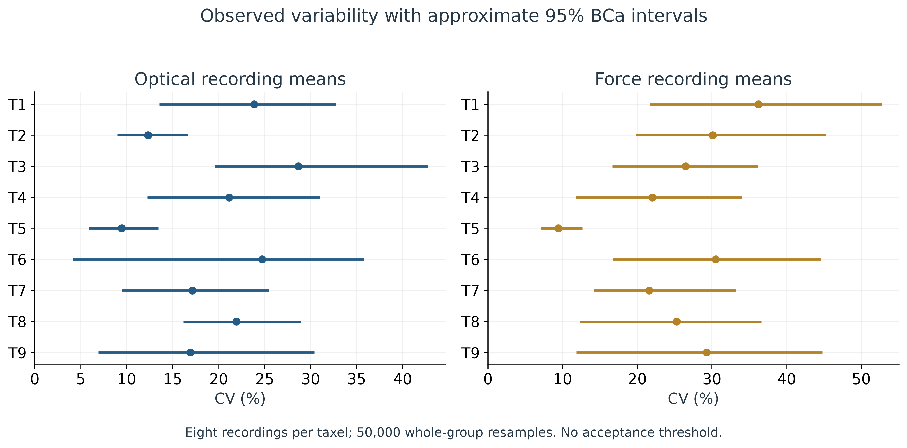
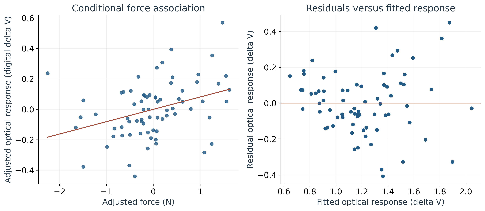
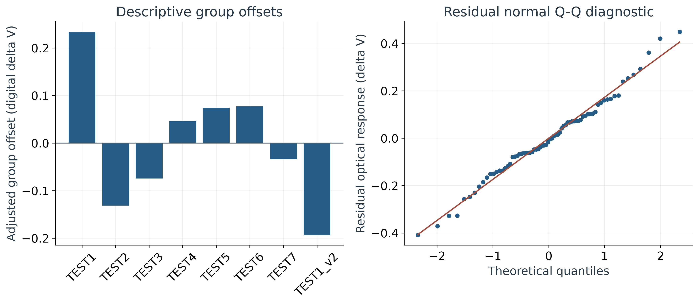
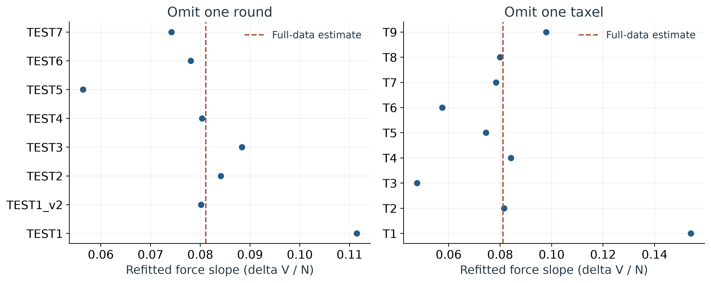

## Part VIII  Repeatability and force-adjusted analysis

**Supplement completed:** 18 October 2026. **Decision requested:** quantify consistency and its uncertainty without an acceptance limit or pass/fail judgment. This section adds completed statistical work to the original 5 October audit. All original measurements, descriptive findings and trained-model artifacts are preserved.

### 1. Main findings and interpretation

Across eight recordings per taxel, observed optical recording-mean CVs range from **9.45% to 28.66%**. The approximate 95% interval is **5.88 to 13.44% for T5** and **19.56 to 42.76% for T3**, the taxels with the lowest and highest point estimates. These are observed extrema, not statistically established rankings. Interval overlap is not an equivalence test.

The pooled within-taxel optical SD is **0.2671 digital delta V**. After allowing for taxel, TEST-group and mean-force differences, the residual SD is **0.1946**, with an approximate 95% BCa interval of **0.1597 to 0.2352**. The fitted common force slope is **0.0811 digital delta V/N**, with a primary group-jackknife 95% interval of **-0.0087 to 0.1708**. Its positive estimate is compatible with a small negative or a larger positive conditional association under this uncertainty calculation.

No application-specific acceptance limit was supplied. Consequently, these estimates quantify the recorded variability; they do not establish that repeatability is sufficient or insufficient for the intended use. Neither an interval containing zero nor a nonsignificant difference establishes equivalence. No pass/fail result, equivalence test, universal CV cutoff, or new trained-model performance result is reported.

### 2. Analytical unit and comparable conditions

The researcher confirmed that the TEST groups were intended to be collected under comparable conditions. The source contains a complete 9-by-8 matrix: one press-designated recording for each taxel T1-T9 in TEST1, TEST2, TEST3, TEST4, TEST5, TEST6, TEST7 and TEST1_v2. All **72 recordings** are retained, including groups used as replay-only data in a separate model-training workflow. That training role does not make their acquisition records ineligible for this quality assessment. The 11 dedicated no-contact recordings remain covered by the original stability analysis and are not treated as contact-response replicates here.

For each recording, Y is the mean target-ROI optical response over the same core-valid, force-defined contact frames used by the original audit; F is the mean synchronized force over those frames. Each recording receives equal weight. All 144 optical/force means were independently recomputed from the original master CSVs; the largest absolute difference from the audited summary was 8.88e-16. Optical delta V refers to the baseline-corrected HSV value channel in the saved motion-magnified pipeline, **not electrical volts**.

The term round below is shorthand for a matched TEST group, not proof of an independently randomized or contiguous collection block. Timestamp ranges for TEST2-TEST6 overlap, and saved baselines are reused across groups. TEST1 recording durations span 103.5-161.4 s, whereas TEST7 spans 18.0-23.5 s. Intended comparable conditions therefore coexist with observed differences in force, recording duration, baseline context and acquisition order. All observations belong to source session S3 on 8 August 2026. The analysis has eight observed group profiles, not 72 independent sessions or thousands of independent frames.

### 3. Repeatability estimates and uncertainty method

For each taxel, the eight recording means were summarized by the arithmetic mean, sample SD with denominator n-1, and CV = 100 x SD / mean. The response means are positive. CV describes relative dispersion on this particular digital feature scale; it is not automatically a metrological relative uncertainty or an intrinsic property of the sensing material. SD remains necessary because CV depends on the mean and the feature's zero point. NIST describes SD as a measure of repeatability precision; the uncontrolled loading and recording aggregation here require the more limited interpretation of observed recording-level dispersion. [NIST repeatability guidance](https://www.itl.nist.gov/div898/handbook/mpc/section4/mpc441.htm).

Approximate 95% bias-corrected and accelerated (BCa) bootstrap intervals were calculated with **50,000 resamples**, seed **20261018**, using SciPy. Each draw samples eight complete TEST-group profiles with replacement. The nine taxels remain matched within each selected profile. Individual frames were never resampled as independent observations. BCa acceleration uses deletion of one whole profile. The same resamples support per-taxel means, SDs, CVs and the model dispersion summaries. [SciPy bootstrap documentation](https://docs.scipy.org/doc/scipy/reference/generated/scipy.stats.bootstrap.html).

These are marginal intervals for each reported statistic, not simultaneous bounds across all nine taxels, prediction intervals for a future recording, or intervals for individual frame values. They are conditional on the observed-session sampling structure and an exchangeability assumption for group profiles. Eight groups are few; bootstrap resampling cannot create independent days, remove confounding or establish nominal 95% coverage when that assumption fails. A diagnostic comparison of the two halves of the bootstrap draws found a maximum difference of 2.04 percentage points in unadjusted optical-CV percentile endpoints. This diagnoses Monte Carlo/discrete-distribution sensitivity; it is not an extra uncertainty margin added to the BCa intervals. Decimal formatting should not be mistaken for precision of that order.

**Table R1. Optical recording-level dispersion.** Each row uses n = 8 recordings. Mean and SD are in digital delta V. Intervals use whole-group BCa resampling.

| Taxel | Mean | SD | 95% interval: SD | CV (%) | 95% interval: CV (%) |
| --- | --- | --- | --- | --- | --- |
| T1 | 1.161 | 0.277 | 0.149 to 0.414 | 23.85 | 13.55 to 32.72 |
| T2 | 1.131 | 0.139 | 0.101 to 0.190 | 12.30 | 8.99 to 16.62 |
| T3 | 1.682 | 0.482 | 0.353 to 0.663 | 28.66 | 19.56 to 42.76 |
| T4 | 0.947 | 0.200 | 0.098 to 0.302 | 21.11 | 12.26 to 30.96 |
| T5 | 0.856 | 0.081 | 0.049 to 0.119 | 9.45 | 5.88 to 13.44 |
| T6 | 1.163 | 0.287 | 0.047 to 0.465 | 24.71 | 4.16 to 35.80 |
| T7 | 1.087 | 0.186 | 0.097 to 0.287 | 17.13 | 9.47 to 25.47 |
| T8 | 1.356 | 0.297 | 0.221 to 0.386 | 21.90 | 16.16 to 28.89 |
| T9 | 1.467 | 0.248 | 0.101 to 0.385 | 16.93 | 6.91 to 30.40 |

T5 has the smallest observed optical CV. T3 has the largest. T6's interval is especially broad relative to its point estimate, illustrating the limited information in eight observations. The source values and uncertainty intervals are retained without deleting high or low recordings. Comparisons among taxels are descriptive; the analysis does not claim a statistically established ordering.

**Table R2. Applied-force variation.** Mean and SD are in N; n = 8 per taxel. The CV intervals describe manual input variability, not uncertainty in the load-cell calibration.

| Taxel | Mean force (N) | SD (N) | Force CV (%) | 95% interval: CV (%) |
| --- | --- | --- | --- | --- |
| T1 | 5.422 | 1.964 | 36.23 | 21.68 to 52.75 |
| T2 | 5.020 | 1.510 | 30.07 | 19.86 to 45.25 |
| T3 | 4.588 | 1.215 | 26.49 | 16.64 to 36.20 |
| T4 | 3.744 | 0.823 | 21.99 | 11.77 to 34.03 |
| T5 | 3.310 | 0.311 | 9.40 | 7.10 to 12.64 |
| T6 | 3.781 | 1.154 | 30.52 | 16.70 to 44.57 |
| T7 | 3.241 | 0.700 | 21.59 | 14.22 to 33.24 |
| T8 | 3.529 | 0.892 | 25.28 | 12.27 to 36.60 |
| T9 | 3.709 | 1.087 | 29.30 | 11.84 to 44.78 |



### 4. Force-adjusted model and uncertainty

An additive fixed-effects regression was fitted to the 72 recording summaries:

```text
Y_tr = intercept + taxel_t + TEST_group_r + beta * (F_tr - 3.5 N) + error_tr
```

This is an ANCOVA-style model with taxel and TEST-group effects. It allows a separate response level for each observed taxel and group, together with one common linear force slope. Ordinary least squares gives one vote to each recording. The design contains an intercept, eight taxel indicators, seven group indicators and one force term: **17 parameters and 55 residual degrees of freedom**. It was full rank. The 3.5 N reference lies inside the common intersection of all nine taxels' observed recording-mean force ranges (2.976-3.812 N). Centering aids interpretation and does not alter the slope or fitted residuals.

The fit is a conditional descriptive adjustment, not a validated calibration function or a causal estimate of force response. It assumes an additive mean structure and a common linear slope; measured mean force is treated as a covariate without propagating load-cell calibration error. It does not make the actual experiments fixed-force trials. With only one recording per taxel-by-group cell, interaction variation and residual variation cannot be separately estimated. Fixed effects avoid assigning an unsupported population distribution to the eight observed group levels.

For the force coefficient, the primary interval uses the **CV3J delete-one-group jackknife**. The complete model, including nuisance effects, is refitted after deleting each TEST group. The jackknife variance is (G-1)/G times the sum of squared differences between the deleted-group slopes and their mean. The interval uses the full-data coefficient plus or minus t(0.975, G-1) times its jackknife SE, with G = 8 and **7 reference degrees of freedom**, rather than treating 72 recordings as independent clusters. The cluster-jackknife approach is described by MacKinnon, Nielsen and Webb; with so few clusters its coverage remains approximate and relies on independence across clusters. [MacKinnon, Nielsen and Webb (2023)](https://journals.sagepub.com/doi/10.1177/1536867X231212433).

**Table R3. Conditional force association and sensitivity to uncertainty method.** All rows refer to the same slope estimate 0.0811 digital delta V/N.

| Uncertainty calculation | Approximate 95% interval | Interpretation |
| --- | --- | --- |
| Primary: delete one TEST group | -0.0087 to 0.1708 | 8 group clusters; t reference with 7 df |
| Sensitivity: delete one taxel | -0.1042 to 0.2664 | 9 taxel clusters; t reference with 8 df |
| Sensitivity: whole-group BCa bootstrap | 0.0244 to 0.1619 | 50,000 complete-profile resamples |

The bootstrap slope interval excludes zero, whereas both jackknife intervals include zero. This method dependence must be retained in the thesis: it is evidence that the uncertainty conclusion is sensitive to the small dataset and dependence assumptions. No preferred significance claim is selected from these alternatives. The taxel calculation examines dependence within a repeated physical taxel, while the primary grouping examines dependence within TEST groups. These are separate sensitivity calculations, **not simultaneous two-way clustering**. Shared session and baseline effects can still link observations across either grouping.

**Table R4. Residual dispersion as adjustment terms are added.** SD is in digital delta V; df is the denominator used for the SD estimate. These are descriptive fits of the same observations, not cross-validated prediction errors.

| Adjustment | Residual df | SD | Approximate 95% BCa interval |
| --- | --- | --- | --- |
| Within taxels; no round or force adjustment | 63 | 0.2671 | 0.2126 to 0.3464 |
| Taxel and TEST-group effects | 56 | 0.2063 | 0.1701 to 0.2456 |
| Taxel, TEST group and mean force | 55 | 0.1946 | 0.1597 to 0.2352 |

Adding mean force to the taxel-and-group model reduces residual SD from 0.2063 to 0.1946, a 5.7% reduction. Its partial R-squared is 0.126: force accounts for 12.6% of the residual sum of squares left after taxel and group effects in this fitted sample. The full model's in-sample R-squared is 0.762, including all taxel and group indicators. Neither quantity measures repeatability acceptance, causal variance attribution or performance on new sessions. Residual SD is not an intrinsic sensor-only error estimate.



### 5. Diagnostics and sensitivity checks

The residual-versus-fitted and normal Q-Q plots were inspected as diagnostics, not used as an automatic pass/fail normality gate. The Q-Q points broadly follow a line with deviations in the tails. Residual RMS differs across taxels, from 0.070 to 0.279 digital delta V, so equal residual dispersion should not be presumed. The maximum leverage is 0.333 and maximum Cook's distance is 0.206. These values were recorded for influence review; no cutoff was used to remove data.

After allowing for mean force, descriptive group offsets range from -0.193 to +0.234 digital delta V relative to the adjusted grand mean. They are calculated from group mean Y minus beta times group mean force centered at 3.5 N, then centered across groups. They describe this fitted sample. They cannot isolate an effect of baseline, elapsed time, operator behavior or material change.

**Table R5. Group context and descriptive offsets.** Each row contains nine taxels; optical means and offsets are digital delta V. No confidence interval or causal interpretation is assigned to these offsets.

| TEST group | Mean force (N) | Mean optical response | Adjusted group offset |
| --- | --- | --- | --- |
| TEST1 | 5.206 | 1.534 | +0.234 |
| TEST2 | 4.528 | 1.114 | -0.131 |
| TEST3 | 4.385 | 1.159 | -0.074 |
| TEST4 | 4.060 | 1.254 | +0.047 |
| TEST5 | 3.997 | 1.277 | +0.075 |
| TEST6 | 4.326 | 1.307 | +0.078 |
| TEST7 | 2.935 | 1.082 | -0.034 |
| TEST1_v2 | 2.867 | 0.917 | -0.193 |



Deleting one group at a time gives slope estimates from 0.0564 to 0.1114; deleting one taxel gives 0.0478 to 0.1541 digital delta V/N. The larger taxel sensitivity, particularly when T1 is omitted, limits confidence in a common population-wide slope. These refits are influence diagnostics; all 72 recordings remain in the reported primary analysis.

**Table R6. Mean-structure sensitivity.** Intervals use the same delete-one-TEST-group method. The log-response row has different units and its residual SD is not directly comparable to the untransformed model. The quadratic row reports the derivative at 3.5 N.

| Model | Force effect | Approximate 95% interval | Effect units |
| --- | --- | --- | --- |
| Common linear force slope | 0.0811 | -0.0087 to 0.1708 | delta V / N |
| Log optical response | 0.0603 | -0.0071 to 0.1278 | log delta V / N |
| Quadratic force term | 0.1352 | -0.0108 to 0.2811 | delta V / N |
| Log duration added | 0.0864 | -0.0159 to 0.1886 | delta V / N |

Each listed interval includes zero. Allowing nine separate taxel force slopes was also examined: residual SD becomes 0.1728 digital delta V with 47 residual degrees of freedom. This more flexible, 25-parameter model is exploratory; eight observations per taxel and one observation per taxel-group cell provide limited support for stable slope-specific interpretation. A smaller fitted residual alone does not establish better generalization. The saved sensitivity table's force coefficient in this interaction model is **T1's reference slope**, not a common slope for all taxels.



### 6. Thesis wording and remaining uncertainty

> Across eight recording-level repetitions for each of nine taxels, optical response CVs ranged from 9.45% to 28.66% under the recorded manual-loading conditions. Whole-group bootstrap intervals showed substantial uncertainty in these dispersion estimates. A model allowing for taxel, TEST-group and mean-force differences yielded a residual SD of 0.1946 digital delta V (approximate 95% BCa interval 0.1597-0.2352). The estimated common force association was 0.0811 digital delta V/N, with a primary group-jackknife interval of -0.0087 to 0.1708. Uncertainty conclusions varied with the resampling and clustering approach. These findings quantify within-session recording variability without establishing a pass/fail judgment, fixed-force per-press repeatability or independent-session reproducibility.

The practical question of sufficient consistency remains open because no application tolerance was defined before analysis. Future work can specify a maximum acceptable SD, CV or force-adjusted response difference based on the downstream sensing requirement, then collect independent sessions with controlled loading and annotated presses. Any later acceptance analysis must identify its criterion and uncertainty method explicitly. This report does not choose a favorable limit after seeing the results. The saved single-reference force calibration, motion magnification, shared baselines, unknown physical-press count and absence of independent days remain limitations after regression adjustment.

### 7. Reproducibility and additional evidence

The executed script is `baurods_quality/repeatability_analysis.py`. It verifies the original archive hash and all 144 recording means, checks the complete 9-by-8 matrix, computes the bootstrap and cluster-jackknife estimates, and exports tables and figures. No recording is excluded. An independent QR solution agreed with the ordinary least-squares coefficients to 2.28e-15; the force coefficient and residual SD also matched a separate calculation using double-centered taxel/group arrays. All 50,000 bootstrap draws and all reported interval endpoints were finite.

Run from the workspace root with the existing analysis environment:

```text
calibration_gui/.venv/Scripts/python.exe baurods_quality/repeatability_analysis.py
calibration_gui/.venv/Scripts/python.exe baurods_quality/build_repeatability_supplement.py
```

The original ZIP is required for the first command and is not embedded in the handoff. The PDF builder at `thesis_handoff/create_pdf_report.py` requires ReportLab, Pillow and pypdf, available in the document runtime used for this report. The numerical environment is Python 3.12.14, NumPy 2.5.1, pandas 3.0.5, SciPy 1.18.0 and Matplotlib 3.11.1. The numerical supplement uses seed 20261018; seed 20261005 in Part VI refers to the original audit's graphical jitter.

The supplement's evidence folder is `outputs/repeatability_20261018`. It contains 13 CSV tables, four 320 dpi PNG/SVG figure pairs, `summary.json` and `analysis.log`. `analysis_recordings.csv` preserves all 72 analysis rows and their original provenance; `repeatability_intervals.csv` retains full-precision means, SDs, CVs and intervals; `force_coefficient_uncertainty.csv`, `model_bootstrap_intervals.csv` and `model_sensitivity.csv` preserve the alternative uncertainty calculations. Residuals, influence refits, force ranges, acquisition context and the baseline crosswalk are also saved. The source ZIP SHA-256 remains `e039dcd49f3390d34dc979490dcf46a6ecc43d9e6a2aec08e4952acc14b5006a`.

The methodological references above support the estimators and their assumptions. They do not provide a BAURods acceptance threshold. The force-adjusted regression is part of this data-quality supplement and must remain distinct from the separate trained-model report.
