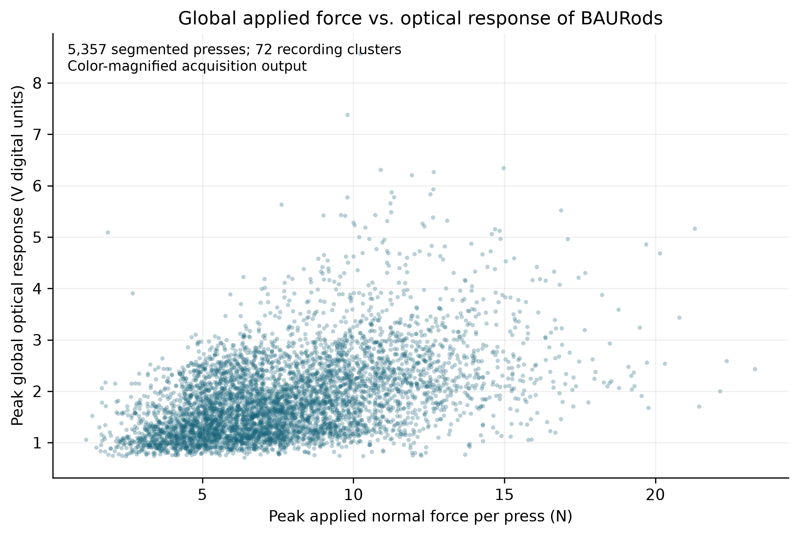
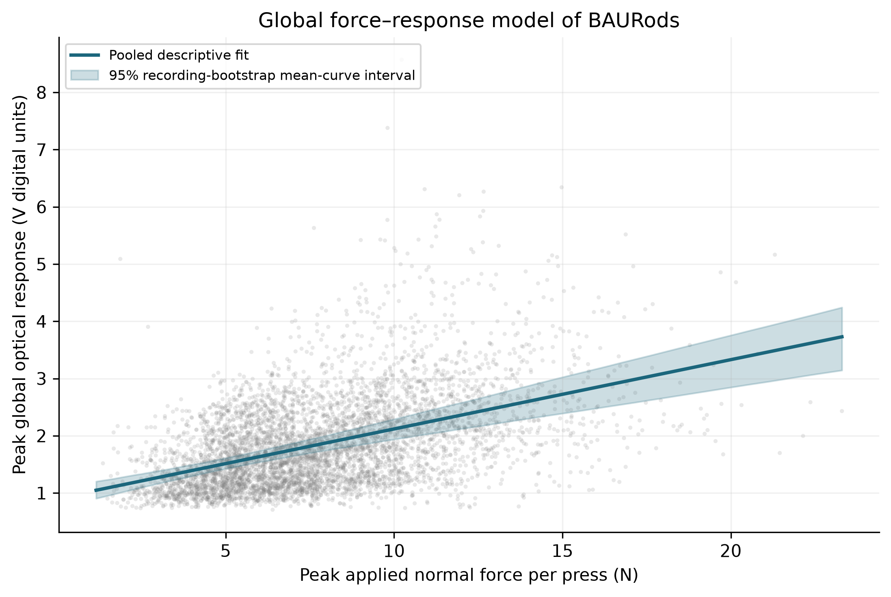
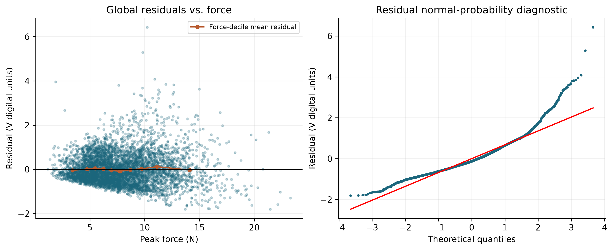
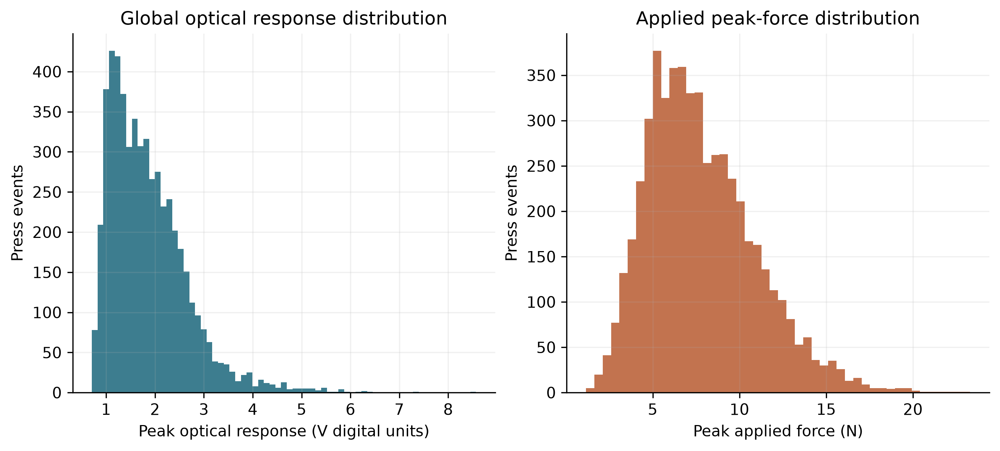
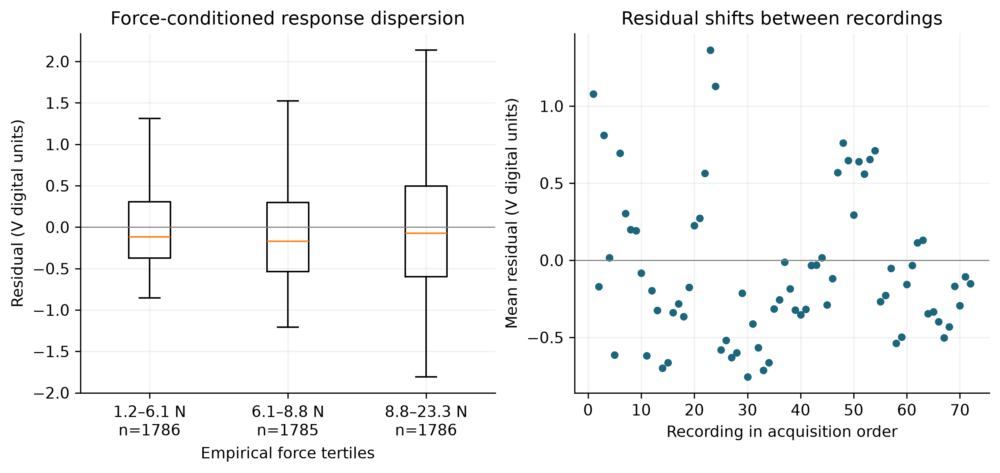
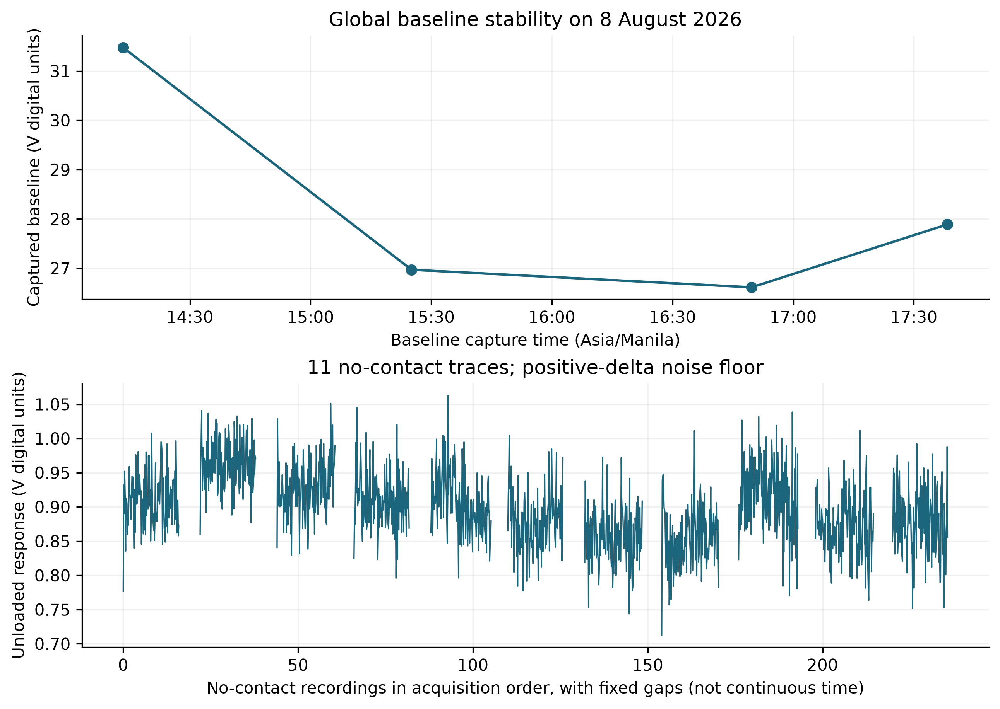
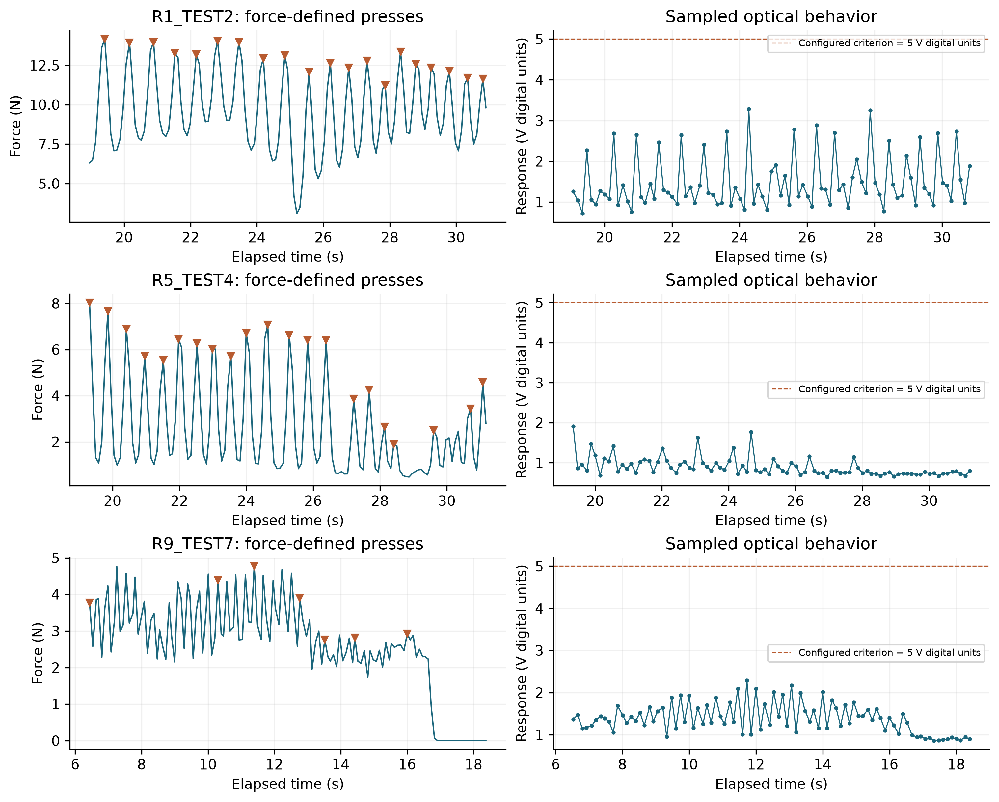
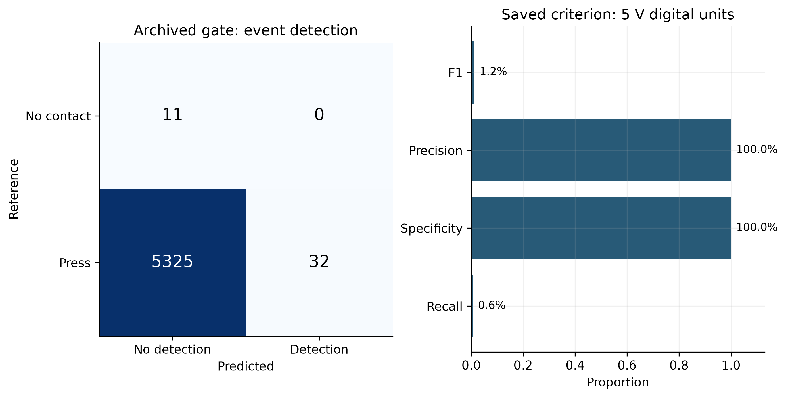
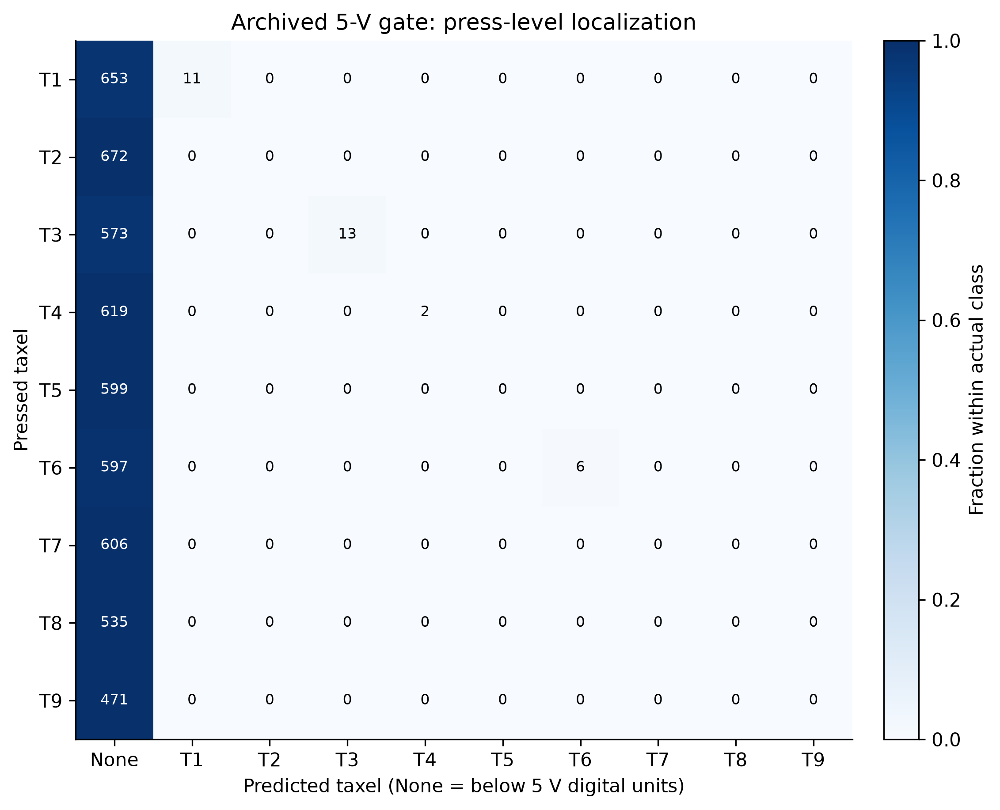

# Global Sensor Characterization of BAURods

Reconciled edition | 19 October 2026. Acquisition: 8 August 2026, session S3. This edition supersedes the 6 October characterization narrative and aligns with the latest complete model report [S1] and data-quality report, including its 18 October statistical supplement [S2].

BAURods demonstrates useful model-assisted contact discrimination and nine-region localization across one integrated 3 × 3 visuotactile skin. The latest retrospectively ranked models achieved **99.24% contact accuracy**, **84.88% localization accuracy**, and **0.4972 N force MAE** under grouped evaluation. The physical characterization establishes a measurable global optical response across manual loading, while the quality supplement quantifies recording-level variability and its uncertainty. These are complementary findings from the same archive, not independent replications.

The strongest defensible conclusion is that the integrated optical sensing system contains useful contact and spatial information and supports moderate force estimation within the evaluated 0.05–3 N interval. Its global optical response alone is not a precise force calibration. Controlled fixed-force repeatability, intrinsic response time, and independent-day reproducibility remain unestablished. No application-specific acceptance limit has been supplied, so this report makes no pass/fail claim.

## 1. Evidence scope and cross-report reconciliation

| Item | Reconciled interpretation | Reason for different reported values |
| --- | --- | --- |
| Latest model headlines | Best evaluated families ranked retrospectively by classification accuracy or force MAE | Earlier nested-selector results evaluate a different selection procedure |
| 72 press recordings; 81 contact runs; 5,357 pulses | Recording count, connected threshold runs, and finer algorithm-inferred loading pulses | None is a verified count of individual physical finger presses |
| Model sample | 54 press recordings; six TEST groups; 7,154 eligible frames | Broader characterization includes 18 replay-designated recordings excluded from this model protocol |
| Contact model sample | 8,506 frames in 65 recordings, including 11 no-contact recordings | Frame metrics differ from event/window or archive-wide gate metrics |
| Baselines | Four baseline captures in the full archive; three in the model subset | Different subsets, not conflicting provenance |
| Optical response | Global magnified positive-clipped peak; target-ROI recording mean; original-video signed correction | Different processing and aggregation produce different slopes and variances |
| R² | 0.2229 global optical fit; 0.3113 held-out force prediction; 0.7617 adjusted recording model | Different dependent variables, covariates, units of analysis, and evaluation methods |
| Gate metrics | 0.127% archive contact-frame accuracy; 0.597% pulse detection recall | Different denominators; neither is the learned detector's 99.24% accuracy |

The user confirmed separate repeated finger presses. This supports the experimental interpretation but does not validate the segmentation count. Pulses can occur without force returning below 0.05 N. Consequently, 81 contiguous threshold-connected contact runs can contain many local loading peaks. Use “algorithm-inferred loading pulses” for the 5,357 retained segments throughout thesis tables and discussion.

## 2. Global response definition and acquisition

The archive contains 83 recordings: 72 press recordings and 11 dedicated no-contact recordings, with 29,318 synchronized frames and 42,568 raw force observations. All belong to one session. Nine taxels form one sensing skin; taxel-specific results are secondary spatial diagnostics, not nine independently validated sensors.

The global optical statistic S is the maximum over each accepted pulse window of the maximum across nine ROI means of positive per-pixel baseline-corrected HSV V. It is measured on archived color-magnified images (amplification 30; passband 1.1–1.2 Hz). V denotes image digital units, not volts or calibrated radiance. Force F is the raw reference peak associated with that window. The optical and force maxima need not occur at the same instant, so their relationship is a pulse-amplitude association rather than an instantaneous transfer law.

Force-only segmentation used 0.5 N peak prominence, minimum 0.15 s peak separation, and at least three camera frames per accepted window. It retained 5,357 pulses; 2,000 candidates were rejected, mostly because fewer than three frames were available. Observations remain clustered within recordings. The physical press count is unverified.

## 3. Global force-response characteristic

| Characteristic | Estimate | Scope |
| --- | --- | --- |
| Observed peak-force span | 1.1512–23.3004 N | Retained pulse maxima; not rated capacity |
| Optical-response span | 0.7071–8.5698 V units | Global magnified positive-clipped pulse response |
| Linear response | S = 0.90855 + 0.12106 F | Pooled descriptive fit |
| Apparent sensitivity | 0.12106 V units/N | Protocol-dependent slope |
| Slope 95% interval | 0.08885–0.14901 V units/N | Recording-cluster bootstrap |
| In-sample fit | R² 0.2229; RMSE 0.7045 V units | Predicting optical response from force |
| Recording-held-out fit | R² 0.1934; RMSE 0.7178 V units | Model-selection cross-validation, not untouched final validation |
| Residual dispersion | SD 0.7046; IQR 0.8394 V units | Manual-loading pulse-level variability |

The positive pooled trend supports an observable system response to loading. Its scatter limits a single global amplitude-to-force calibration. The 23.3004 N raw-force peak and the quality report's 22.699 N synchronized-force maximum use different sampling streams; the camera-aligned stream can miss raw-force extrema. The model's 0.05–3 N eligibility interval is narrower than both, and its reported prediction error cannot be extended to the full peak-force span.

## 4. Response dispersion under manual loading

Pulse-level residual SD of 0.7046 V units describes deviations from the global line under varying force, position, baseline context, and manual loading. It is a conditional dispersion proxy, not fixed-force sensor repeatability. The response distribution and force-conditioned spread should be interpreted alongside those uncontrolled factors. Selecting only visually favorable pulses would change the estimand and is not used here.

## 5. Updated recording-level repeatability evidence

The quality supplement [S2] uses 72 recording means: nine taxels across eight TEST groups. Each response is the labelled target ROI's mean positive pixel delta-V, averaged over valid force-derived contact frames (force at least 0.05 N). Each recording has one observation and equal weight. Between-recording optical CV ranges from **9.45% to 28.66%**, with eight observations per taxel. This quantifies within-session variation under manual loading.

The adjusted model includes an intercept, taxel effects, TEST-group effects, and mean force centered at 3.5 N. It has 17 parameters and 55 residual degrees of freedom. The common overlap of recording-mean force across taxels is approximately 2.976–3.812 N; 3.5 N is an adjustment reference, not a newly performed fixed-force test.

| Recording-level statistic | Estimate | Uncertainty or interpretation |
| --- | --- | --- |
| Pooled within-taxel SD | 0.2671 delta-V | 95% BCa interval 0.2126–0.3464 |
| Taxel/TEST-adjusted SD before force term | 0.2063 delta-V | Residual variation after blocking |
| Force-adjusted residual SD | 0.1946 delta-V | 95% BCa interval 0.1597–0.2352 |
| Common force association | 0.0811 delta-V/N | Primary TEST-group jackknife 95% interval −0.0087–0.1708 |
| Full model R² | 0.7617 | In-sample variance explained jointly by all terms |
| Partial R² for force | 0.1261 | Incremental explanation relative to blocked model |

The force term reduces residual SD by about 5.7%, from 0.2063 to 0.1946. The full R² of 0.7617 is not force-prediction accuracy and does not mean force alone explains 76.17% of response variation. The primary delete-one-TEST-group jackknife uses eight clusters and a t interval with seven degrees of freedom; it includes zero. The whole-group BCa slope interval (0.0244–0.1619) excludes zero, while the taxel-jackknife interval also includes zero. Thus inference about a common force association depends on the uncertainty method. The source uses 50,000 paired whole-group bootstrap resamples, retaining all nine taxels in each sampled group rather than resampling individual frames.

The global pulse slope's positive interval and the adjusted recording slope's zero-crossing interval do not contradict each other: the response statistic, aggregation, covariates, weighting, and uncertainty procedures differ. Neither establishes an intrinsic material sensitivity. No acceptance threshold or sufficient-repeatability verdict is inferred from the observed CVs.

## 6. Baseline stability and noise

Across the 11 unloaded recordings, the global maximum-ROI statistic has a recording-equal mean of 0.8980 V units, RMS within-recording SD of 0.04372 V units, and temporal CV proxy of 4.87%. Between-recording SD is 0.03316 V units. The median pulse-excess-to-baseline-noise ratio is 18.41; it is a processing-dependent SNR proxy, not a physical signal-to-noise specification or detection limit.

The quality report instead evaluates 99 individual recording/ROI traces. Raw mean-V CV spans 0.312–0.725%; positive-corrected ROI CV spans 5.50–9.14%, with means 0.502–0.915 delta-V. These are different statistics from the global maximum-ROI trace. Positive clipping gives a nonzero unloaded response. The observed short recordings support short-term baseline stability only, not stability across independent days or environmental conditions.

## 7. Temporal behavior and unresolved physical metrics

Median camera spacing is approximately 0.1301 s (about 7.69 Hz), compared with 0.09188 s for raw force. A retained pulse has a median of only four camera frames, and only one accepted event has unloaded boundaries on both sides. Filtering and sparse sampling prevent defensible intrinsic response-time, recovery-time, hysteresis, or bandwidth estimates. The sampled traces are useful descriptions of observed behavior, not step-response tests.

No saturation limit, minimum resolvable force, calibrated detection limit, or independent-day reproducibility is established. The previously reported 41.10 ms timing refers to an offline audit of the original inference bundle. It is neither sensor response time nor a measured latency of the latest winning-model combination.

## 8. Archived gate and spatial information

The saved 5-V acquisition gate detects 32 of 5,357 retained pulses, giving **0.597% pulse recall**, with 5,325 missed pulses. All 11 unloaded recording windows are negative. Specificity is 100% on those 11 windows, but this small control set does not establish a population false-positive rate. Combining pulse and unloaded-window units yields 0.801% diagnostic accuracy; it is not comparable to a frame-weighted model score.

The quality report's archived localization accuracy/coverage of **0.127%** is evaluated on contact frames. The pulse-level gate and localization calculation uses pulse maxima, so its denominator and sampling differ. These low archived-gate results are retained transparently and do not describe the subsequently trained detector.

When contact is assumed known and the global peak is localized by ungated ROI argmax, pulse-level localization is 94.31% (macro F1 0.9444). This favorable spatial result shows useful location information, but it is conditional on known contact and uses different features and units from the learned 84.88% frame-level localization result. It must not be advertised as end-to-end contact-and-location accuracy.

## 9. Updated model-assisted sensing performance

The latest complete model report [S1] selects the highest-accuracy classification families and the lowest-MAE force family among evaluated models. These winners were ranked retrospectively using outer evaluation results. Their predictions come from six complete held-out TEST groups with equal total weight per recording. Family ranking on those results does not create an untouched prospective test set.

| Task and selected model | Principal result | Supporting metrics |
| --- | --- | --- |
| Contact: tuned RBF SVC | Accuracy 99.24% | Balanced accuracy 99.54%; macro F1 0.9867 |
| Nine-region localization: tuned logistic regression | Accuracy 84.88% | Balanced accuracy 84.88%; macro F1 0.8500 |
| Force: tuned ensemble | MAE 0.4972 N | RMSE 0.6299 N; R² 0.3113; bias +0.0827 N |

Contact recall is 99.09%, with 100% observed precision and specificity in this evaluation. Contact uses 8,506 frames from 65 recordings: 7,154 eligible press frames from 54 recordings and 1,352 no-contact frames from 11 recordings. Force and localization use the 7,154 press frames, restricted to 0.05–3 N. All use original, unannotated video features. Correlated frames are not independent experimental repetitions. The learned pipelines were evaluated offline; these scores do not imply deployment into the archived acquisition GUI.

| Evaluation policy | Contact accuracy | Localization accuracy | Force MAE |
| --- | --- | --- | --- |
| Latest retrospectively ranked families | 99.24% | 84.88% | 0.4972 N |
| Previously reported nested selector | 97.51% | 84.40% | 0.4991 N |

The earlier nested selector's contact balanced accuracy was 98.50%, and its joint correct-contact-and-region score was 83.61%. Those remain historical results of that procedure. They are not scores of the current winning-model combination. No new joint score or winner-combination timing is inferred in this revision. Localization macro F1 of 0.8500 belongs to the accuracy-winning logistic model; the ensemble's slightly higher macro F1 must not be combined with logistic accuracy as though they described one model.

## 10. Original-video baseline correction and normalization

The model report's new optical analysis uses original-video ROI mean V, the saved baseline mean V0, signed correction V − V0, and normalized correction 100 × (V − V0)/V0. It includes the same 7,154 eligible frames and 54 recordings, with equal recording weights within each taxel. This signed difference of means is distinct from the archived mean of positive per-pixel differences on magnified images.

The following descriptive R² values are squared weighted correlations of each optical signal with force, not held-out force-prediction R². Baseline correction improves pooled association for eight of nine taxels; T1 decreases. Normalization adds only modest changes and does not itself establish improved trained-model accuracy.

| Taxel | Raw V R² | Signed corrected R² | Normalized R² |
| --- | --- | --- | --- |
| T1 | 0.0322 | 0.0036 | 0.0052 |
| T2 | 0.0000 | 0.0775 | 0.0775 |
| T3 | 0.0994 | 0.2963 | 0.3026 |
| T4 | 0.0288 | 0.0660 | 0.0654 |
| T5 | 0.0003 | 0.0768 | 0.0735 |
| T6 | 0.0881 | 0.1059 | 0.1122 |
| T7 | 0.0002 | 0.0379 | 0.0389 |
| T8 | 0.0121 | 0.1250 | 0.1262 |
| T9 | 0.0187 | 0.1702 | 0.1755 |

Subtracting a fixed baseline and dividing by a positive fixed baseline preserves within-recording correlation. Changes in pooled correlations therefore concern between-recording offsets and scaling. The three saved baseline captures used by this subset are consistent with four captures in the broader archive.

## 11. Interpretation for thesis use

The results support BAURods as an integrated optical sensing skin with useful spatial discrimination and strong retrospective learned contact classification under the evaluated conditions. Force estimation is supported over 0.05–3 N with about 0.50 N MAE, while moderate force R² and broad global-response scatter limit claims of precision. Baseline correction helps harmonize original-video optical measurements across most locations without resolving all location dependence.

The recording-level supplement strengthens the characterization by adding uncertainty-aware variability estimates. It does not convert manual loading into a controlled repeatability test. One session, shared baselines, unknown physical-press count, processing-dependent brightness, and family selection using evaluation results constrain generalization. These limitations qualify the demonstrated capabilities without negating the useful contact and spatial information.

## 12. Characterization summary

Use the current winning-model metrics with their retrospective ranking and 0.05–3 N labels; retain the nested-selector scores only when discussing that evaluation procedure. Use 5,357 algorithm-inferred pulses, 81 threshold-connected contact runs, and 72 press recordings as separate quantities. Use 0.1946 delta-V as the adjusted recording residual SD and 0.7046 V units as the global pulse residual SD, always naming the response and unit of analysis.

For future independent validation, specify application tolerances before testing, control loading and unloading, annotate physical presses, and collect separate sessions. This edition reconciles existing evidence; it does not retrain models, add experimental observations, or establish new acceptance criteria.
